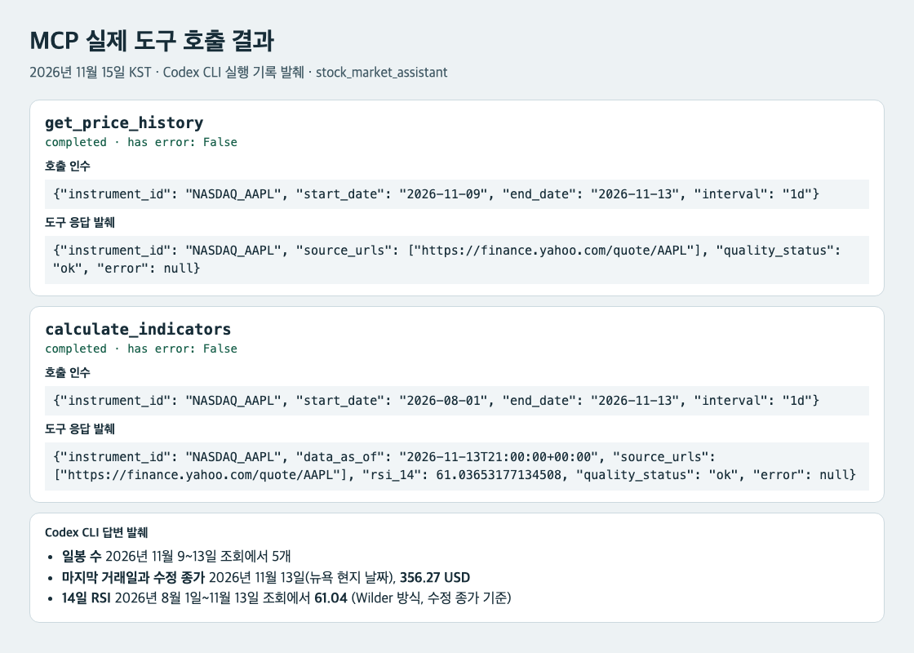
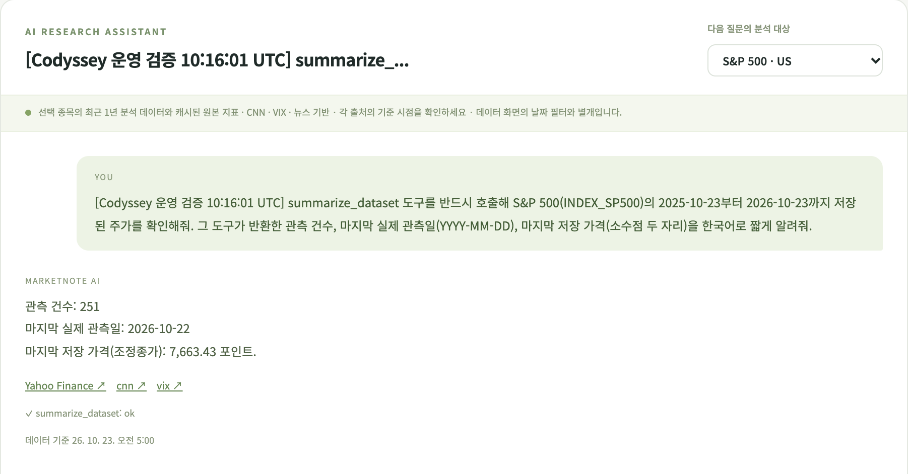

# 한국·미국 주식시장 AI 비서

Yahoo의 실제 일봉을 Firestore에 저장하고, 저장한 데이터 요약으로 답하는 AI 비서를 개발합니다. 전체 설계는 [프로젝트 설계서](docs/project-design.md)에 있습니다.

**마켓노트**는 Vercel과 Render에서 운영 중입니다. 로그인 후 실제 시세와 한·미 뉴스, Codyssey AI 채팅, Discord 브리핑 이력과 가격 알림을 확인할 수 있습니다.

| 운영 주소 | 용도 |
| --- | --- |
| [마켓노트 웹](https://codyssey-m1-2-gold.vercel.app/) | 로그인, 데이터 조회, 채팅, 뉴스·알림 |
| [Render API](https://stock-market-assistant-api.onrender.com) · [헬스 체크](https://stock-market-assistant-api.onrender.com/healthz) | 백엔드 주소와 응답 상태 |
| [Swagger UI](https://stock-market-assistant-api.onrender.com/docs) · [OpenAPI JSON](https://stock-market-assistant-api.onrender.com/openapi.json) | API 명세와 인증을 사용한 호출 확인 |

실제 계정·키 준비는 [첫 배포 안내](docs/first-deploy.md), 서비스별 설정과 운영은 [배포 런북](docs/deployment.md)을 따릅니다.

## 보너스 과제 평가 안내

Function Calling, 외부 MCP, 실제 가격 그래프와 다크 모드를 구현했습니다. CSV/JSON 다운로드는 미구현 상태입니다. 아래 캡처와 호출 기록은 서비스에 로그인하지 않아도 확인할 수 있습니다.

| 평가 항목 | 증빙에서 확인할 내용 |
| --- | --- |
| Function Calling | 운영 채팅의 `summarize_dataset` 호출 성공 기록과 Yahoo 출처를 확인할 수 있습니다. 답변의 S&P 500 관측 251건과 마지막 수정 종가 7,663.43은 별도로 조회한 데이터 요약과 일치했습니다. [운영 채팅 화면](#운영-채팅-화면) |
| 외부 MCP | 별도 Codex CLI 채팅에서 `get_price_history`와 `calculate_indicators`를 호출해 AAPL 일봉 5건과 Wilder RSI(14) 61.04를 확인했습니다. [실제 호출 결과 캡처](#mcp-실제-도구-호출-결과) · [재현 절차](docs/mcp.md#codex-cli-채팅-검증) |
| 실제 가격 그래프 | 로컬 브라우저 검증 화면의 **기록의 흐름**에서 Yahoo AAPL 수정 종가 3건(2025년 10월 21~23일)이 그래프와 데이터 표에 함께 표시됩니다. [가격 그래프 캡처](docs/screenshots/price-chart.png) |
| 다크 모드 | 운영 웹 오른쪽 위의 **다크 모드** 버튼으로 밝은 화면과 어두운 화면을 전환합니다. 로그인 전에 바로 확인할 수 있으며, 새로고침해도 같은 브라우저에 선택이 유지됩니다. [마켓노트 웹](https://codyssey-m1-2-gold.vercel.app/) |

운영 웹에서 채팅과 가격 그래프를 직접 확인하려면 접근이 허용된 평가용 계정이 필요합니다.

1. [AI 리서치 대화](https://codyssey-m1-2-gold.vercel.app/#chat)에서 보유한 종목 데이터의 관측 수와 마지막 가격을 `summarize_dataset`으로 확인해 달라고 요청합니다. 답변의 도구 호출 기록과 출처를 확인합니다.
2. [데이터 워크스페이스](https://codyssey-m1-2-gold.vercel.app/#data)에서 종목과 기간을 선택한 뒤 **조회하기**를 누릅니다. 저장된 데이터가 비어 있으면 **Yahoo 데이터 수집**으로 해당 기간의 데이터를 가져옵니다. **기록의 흐름** 그래프와 아래 데이터 표를 확인합니다.

외부 MCP를 직접 재현하려면 로컬 stdio 서버를 Codex CLI에 등록합니다. 설정과 실제 호출에 사용한 종목·기간은 [MCP 연결 안내](docs/mcp.md#codex-cli-채팅-검증)에 있습니다.

### MCP 실제 도구 호출 결과

2026년 11월 15일(KST) Codex CLI 실행 기록에서 두 도구의 호출 인수, 완료 상태, 응답 일부와 채팅 답변을 발췌했습니다. 두 호출 모두 오류 없이 완료됐으며, 답변에서 AAPL 일봉 5건, 11월 13일 수정 종가 356.27 USD, Wilder RSI(14) 61.04를 확인할 수 있습니다.



## 구현 범위

- Python 가상환경, 버전 잠금, FastAPI·Swagger·CORS·요청 ID·오류 응답.
- Firebase ID token 검증과 허용 UID 제한. 미인증 요청은 401, 타인 데이터는 404.
- 한국·미국 9개 종목·지수의 실제 완료 일봉 수집. 거래일·조기 폐장·UTC 기준 시각, 원래 종가와 조정 종가 보존.
- `instruments`·`market_bars` 원본과 수정 가능한 사용자 `data` 분리, 중복 방지·revision 충돌 검사.
- 데이터 CRUD·전체 필터 요약, 대화 저장·목록·메시지 페이지 조회·하위 문서 삭제.
- 서버 요약을 주입하는 AI 채팅(Codyssey Chat Completions 또는 OpenAI Responses), 자동 저장·재시도·동시 요청 제한, `summarize_dataset`·`search_news`·`get_us_sentiment`·`get_market_analysis` 도구.
- 프레임워크 없는 HTML/CSS/JS 화면: Firebase 이메일 로그인, 실제 Yahoo 수집, CRUD·기간 전체 요약·목록 차트, AI 채팅과 대화 기록 복원, 모바일 화면.

시장 브리핑 화면에서 원본 지표·뉴스 요약·미국 시장 심리를 확인할 수 있습니다. 가격 알림은 별도의 실제 정규장 5분 봉 종가를 사용합니다. 일봉의 `event_time`은 거래소 세션 종료 시각이고 `fetched_at`은 공급원 수집 시각입니다. 데이터가 없거나 외부 호출이 실패하면 가짜 값으로 대체하지 않습니다.

## 운영 채팅 화면

Codyssey의 실제 답변입니다. `summarize_dataset`으로 S&P 500 저장 데이터 251건을 확인했고, 마지막 관측일인 2026년 10월 22일의 수정 종가 7,663.43포인트가 Firestore 요약과 일치했습니다. 아래 화면은 저장된 대화를 다시 열어 캡처했으며, 출처 링크와 도구 성공 기록도 함께 복원됐습니다.



## 개발 환경

Python **3.12**를 사용합니다. 설계의 Python 3.11 기준을 충족하는 상위 버전이며, 현재 작업 환경에서 제공되는 3.12.14로 검증했습니다. 지원 범위는 3.11~3.13입니다. `uv.lock`은 개발 환경, `requirements.lock`은 Render 실행 의존성을 고정합니다.

```bash
uv sync --locked --extra dev
cp .env.example .env
```

`uv` 없이 실행할 때:

```bash
python3.12 -m venv .venv
source .venv/bin/activate
python -m pip install -r requirements.lock
```

개발 검사에는 `uv sync --locked --extra dev`로 pytest·ruff도 설치하세요. 이후 명령은 프로젝트 루트에서 실행합니다.

## Firebase 설정

1. Firebase Console에서 프로젝트와 **Firestore Native mode `(default)` DB**를 생성합니다.
2. Authentication에서 사용할 로그인 제공자를 활성화하고 테스트 사용자를 준비합니다.
3. 서버용 서비스 계정 JSON을 받아 저장소 밖에 보관하고, `.env`의 `GOOGLE_APPLICATION_CREDENTIALS`에 파일 경로를 입력합니다. Render에서는 대신 `FIREBASE_SERVICE_ACCOUNT_JSON`에 한 줄 JSON을 설정할 수 있습니다. 둘 중 하나만 사용합니다.
4. `.env`에 `FIREBASE_PROJECT_ID`, `ALLOWED_USER_UIDS`, `JOB_OWNER_UID`를 입력합니다. 두 UID에는 Authentication의 동일 사용자 UID를 넣습니다. 허용 목록을 비워 두면 개인 API는 접근을 허용하지 않습니다.
5. Firebase CLI를 사용한다면 인덱스와 규칙을 배포합니다. 아래 명령은 지정한 클라우드 프로젝트 설정을 변경하므로 프로젝트 ID를 확인하고 직접 실행하세요.

```bash
firebase deploy --only firestore:rules,firestore:indexes --project YOUR_PROJECT_ID
```

브라우저의 Firestore 직접 접근은 `firestore.rules`로 차단합니다. 서버의 Admin SDK는 규칙을 우회하므로 모든 개인 API에서 UID·소유권을 확인합니다. 인덱스 빌드가 끝난 뒤 조회하세요. 에뮬레이터는 복합 인덱스 존재를 강제하지 않으므로 클라우드에서도 확인해야 합니다.

## 실제 데이터 수집

Yahoo에는 키가 필요하지 않습니다. 기본은 9개 대상 각각 최근 1년, 최소 100개 실제 일봉이며, 최소 수에 미달하면 해당 대상은 저장하지 않고 실패를 보고합니다. 실행 중 다른 종목이 실패해도 성공한 종목은 저장되며 종료 코드는 1입니다. 재실행으로 이어서 수집할 수 있습니다.

```bash
.venv/bin/python -m jobs.bootstrap_data
# 두 시장의 대표 종목만 먼저 저장
.venv/bin/python -m jobs.bootstrap_data --instruments KRX_005930 NASDAQ_AAPL
# 명시적 기간: 양 끝 날짜 포함
.venv/bin/python -m jobs.bootstrap_data --instruments INDEX_SP500 --start 2025-10-01 --end 2026-10-01
# Firebase 설정 전에도 가능한 실제 공급원 수집 점검; DB에는 쓰지 않음
.venv/bin/python -m jobs.bootstrap_data --fetch-only --instruments KRX_005930 NASDAQ_AAPL --output artifacts/yahoo-real.json
# 저장 후 전체 건수·출처 확인과 저장된 원본 재가져오기 중복 검사
.venv/bin/python -m jobs.verify_data --check-reimport --output artifacts/verification.json
```

지원 ID: `INDEX_KOSPI`, `INDEX_KOSDAQ`, `INDEX_SP500`, `INDEX_NASDAQ`, `INDEX_VIX`, `KRX_005930`, `KRX_000660`, `NASDAQ_AAPL`, `NASDAQ_MSFT`. 기간은 최대 730일입니다. 당일 아직 끝나지 않은 세션은 저장하지 않습니다.

`data.value`는 수집 당시 조정 종가를 복사합니다. 사용자 수정은 재수집에서 보존합니다. 삭제는 원본과 분리된 사용자 문서에 삭제 표식을 남겨 재수집으로 되살아나지 않도록 합니다. 원본 정정 시 수정하지 않은 복사본만 갱신합니다. 개별 종목 저장은 최대 100개 관측치씩 트랜잭션으로 처리하므로 중간 실패 뒤 재실행해도 중복되지 않습니다.

## 뉴스·시장 심리·기술 지표

`.env`에 `NAVER_CLIENT_ID`, `NAVER_CLIENT_SECRET`, `FINNHUB_API_KEY`를 입력하고 API를 재시작합니다. 신규 Naver 키는 [NAVER API HUB](https://guide.ncloud-docs.com/docs/apihub-migration)의 검색 API를 신청하고 `NAVER_API_MODE=api_hub`(기본값)로 사용합니다. 2026-07-31 이전 개발자센터에서 발급한 키는 `legacy`로 명시해야 하며, 기존 서비스는 2027-06-30 종료 예정입니다. 두 방식의 키를 자동으로 교환하거나 재시도하지 않습니다. API HUB는 현재 무료 플랜을 제공하며 향후 정책은 신청 화면에서 확인하세요. [Finnhub](https://finnhub.io/docs/api/market-news)는 무료 키를 사용합니다. 키를 입력하지 않은 시장은 설정 필요 상태이며 가짜 뉴스로 대체하지 않습니다. 키는 백엔드에만 둡니다.

로그인 후 **시장 브리핑**에서 종목과 뉴스 기간(24시간/7일)을 선택합니다. 완료된 최근 1년의 Yahoo 일봉, CNN, VIX, 해당 시장의 뉴스를 병렬 수집합니다. 국내 뉴스는 Naver 시장·종목 키워드, 미국 개별 종목은 Finnhub company-news, 미국 지수는 general 시장 뉴스입니다. `GET /api/news?market=KR&window=24h`처럼 종목을 생략하면 전체 시장 키워드로 조회합니다. 조회 범위는 공급원이 반환한 기사에 한정되며 7일 전체 뉴스를 보장하지 않습니다. URL 및 같은 발행일의 제목·출처로 중복을 제거하고 최신 50건까지 저장·표시합니다. Naver 조회는 최대 500건이며 잘린 결과는 표시합니다.

뉴스 API가 만료된 항목을 수집할 때 OpenAI가 설정되어 있으면 제공된 제목·요약으로 한국어 요약을 만들고 기사 ID와 원문 링크를 연결합니다. 원문 전문은 수집하지 않습니다. 모델 미설정·실패·잘못된 인용은 실제 제목·요약 발췌 모드로 표시합니다. 미국 발췌 뉴스는 공급원 언어 그대로입니다. 채팅 뉴스 도구는 별도 요약 모델을 호출하지 않고 주 모델이 예산 안에서 직접 요약합니다. 도구가 먼저 갱신한 공유 뉴스 캐시는 발췌 모드일 수 있으며, 웹의 별도 AI 요약은 다음 만료 수집 때 생성합니다.

CNN은 [공식 화면](https://www.cnn.com/markets/fear-and-greed)이 사용하는 비공식 JSON 피드이며 공개 API 계약은 없습니다. 미국 주식 지수임을 명시하고 점수·분류·직전 종가·1주/1개월/1년 비교와 과거 관측을 저장합니다. 수집 성공이어도 관측이 36시간보다 오래됐으면 지연 상태입니다(주말 포함). 접근 차단·형식 변경 시 마지막 실제 값과 오류를 반환합니다.

기술 지표는 **사용자 수정값을 제외한 `market_bars.adjusted_close`**로 계산합니다.

| 지표 | 계산 기준 |
| --- | --- |
| 1·5·20·60일 수익률 | 최근 관측 종가 / n개 전 관측 종가 − 1; n+1개 필요 |
| 20일 실현 변동성 | 최근 20개 로그수익률의 표본 표준편차(ddof=1) × √252 × 100; 21개 필요 |
| SMA-20/60·이격률 | 최근 20/60개 종가 평균, 현재 종가 대비 거리(%) |
| RSI-14 | 최초 14개 변화의 평균 상승/하락으로 시작해 Wilder 재귀 평활; 보합 50·상승만 100·하락만 0 |
| 거래량 비율 | 최신 거래량 / 직전 20개 양수 거래량 평균; 0·결측이 있으면 null |
| VIX | 미국 기대 변동성 지수의 원본 종가, 전일 변화(%), 최근 최대 252개 종가에서 현재 값 이하 비율(%) |

결측 거래일을 보간하지 않습니다. 부족한 기간의 지표는 `null`이고 사용 가능한 짧은 기간의 값은 유지합니다. 거래소의 마지막 완료 세션보다 일봉이 오래됐으면 지연으로 표시합니다. VIX 값과 주가의 20일 실현 변동성은 다른 수치입니다.

`NEWS_CACHE_MINUTES`·`SENTIMENT_CACHE_MINUTES`·`ANALYSIS_CACHE_MINUTES`는 기본 30분입니다. 새로 확인은 만료된 항목만 수집하며, 실패 후에는 최대 5분 동안 재시도를 억제합니다. Firestore의 `research_cache`가 다중 프로세스의 수집을 3분 임대로 조정하고 시도 토큰으로 늦은 캐시 덮어쓰기를 차단합니다. 아직 수집이 진행 중이면 비어 있거나 이전 상태일 수 있으므로 이후 다시 확인합니다. 원본 `market_bars`, `news_articles`, 일별 `sentiment`도 저장합니다. 지표 갱신은 사용자 `data`를 생성·수정하지 않습니다.

응답의 `quality_status`는 `ok`·`stale`·`unavailable`·`insufficient_data`이며 구성요소마다 적용합니다. `event_time`/`data_as_of`는 관측 시각, `fetched_at`은 마지막 성공 수집, `last_attempt_at`은 마지막 시도입니다. 일부 공급원 실패여도 나머지 실제 데이터는 반환합니다. 오래된 뉴스는 조회 기간 밖으로 나가면 요약에서도 제외합니다.

AI 채팅은 저장된 지표·CNN·VIX·최근 기사 5건을 서버 문맥으로 읽고 필요한 정보는 위 도구로 수집합니다. 데이터 화면의 날짜 필터와 별개인 최근 1년 원본 분석입니다. 출처와 도구 이력은 답변과 대화 기록에 저장합니다. 외부 MCP에서도 같은 조회·계산 서비스를 사용하며, 연결은 [MCP 안내](docs/mcp.md)를 참고하세요.

## Discord 정기 브리핑

Discord 일반 텍스트 채널의 **채널 편집 → 연동 → 웹후크**에서 URL을 만들고 서버 `.env`의 `DISCORD_WEBHOOK_URL`에 입력합니다. `https://discord.com/api/webhooks/ID/TOKEN` 또는 `/api/v10/webhooks/ID/TOKEN` 형식만 허용합니다. 웹후크는 서버의 `default` 목적지 하나로 고정되며 브라우저·DB·AI 도구에 노출하지 않습니다. 포럼·미디어 채널의 스레드 생성은 지원하지 않습니다. API를 재시작하고 로그인한 뒤 **Discord 정기 브리핑** 메뉴에서 예약을 설정하세요.

- 한국 또는 미국 시장을 선택하고 같은 시장의 관심 종목·지수를 최대 4개 추가합니다. 양쪽 시장은 예약을 각각 만듭니다.
- **장 마감 이후**: 한국 XKRX·미국 XNYS 달력의 실제 마감 + 0~180분(기본 40분). 휴장일은 건너뛰고 미국 조기 폐장·서머타임을 반영합니다. 거래소 달력을 읽지 못하면 임의 평일로 대체하지 않습니다.
- **시각 지정**: IANA 시간대·현지 시각·요일을 선택합니다. 선택 요일 기준이며 거래소 휴장일에도 실행합니다. 서머타임 시작으로 존재하지 않는 현지 시각은 건너뛰고, 종료 때 반복되는 시각은 첫 번째 한 번만 실행합니다.
- 미리보기는 실제 자료로 브리핑을 저장하며 전송하지 않습니다. **Discord 전송 예약**을 누르면 저장한 본문이 큐에 들어갑니다. 전송 이력의 상태·부분별 시도 횟수·메시지 ID·실패·결과 불확실 여부를 확인하고 실패한 전송을 다시 예약할 수 있습니다.
- 소유자당 예약 생성은 삭제 표식을 포함해 최대 100개입니다. 기존 예약을 수정해 재사용할 수 있습니다.
- 수정·일시정지·삭제는 앞으로 생성할 예약에 적용합니다. **이미 큐에 들어간 브리핑은 전송될 수 있습니다.** 삭제한 예약 ID와 생성 키는 재사용하지 않습니다.

별도 워커가 필요합니다. 웹 API 프로세스에 타이머를 넣지 않으므로 API만 실행하면 예약과 수동 전송 모두 대기 상태입니다. 워커는 허용 목록에 있는 `JOB_OWNER_UID` 한 명의 예약·큐만 처리합니다. 다른 소유자는 해당 UID로 별도 실행합니다.

```bash
# 한 번 실행: 외부 cron이 이 명령을 1~5분 간격으로 호출할 수 있습니다.
.venv/bin/python -m jobs.tick
# 로컬에서 계속 실행: 기본 60초 간격, 종료는 Ctrl-C
.venv/bin/python -m jobs.tick --loop --interval 60
```

프로세스가 살아 있고 인터넷과 Firestore에 연결되어 있어야 합니다. 전송 시각은 다음 워커 실행 시각까지 늦어질 수 있습니다. 워커가 오래 중단되면 지난 예약 시각 하나에 대한 최신 브리핑만 생성하고 다음 시각을 현재 이후로 이동합니다. 누락된 모든 시각을 한꺼번에 발송하지 않습니다. Render 무료 웹 서비스의 수면 상태에서는 정기 실행을 보장할 수 없습니다. `render.yaml`은 웹 API만 구성하며 유료 워커·cron을 자동으로 생성하지 않습니다.

본문에는 시장 대표 지수, 관심 종목의 종가·수익률·20일 연율 변동성·RSI, 미국 VIX·CNN 주식 공포탐욕지수, 시장·관심 종목별 최신 뉴스 최대 3개와 공급원 요약·원문 링크를 포함합니다. 예약 뉴스는 이전 **성공 전송 브리핑의 생성 시각 이후**, 첫 전송은 최근 24시간을 조회하며 최대 7일·공급원 결과 범위로 제한합니다. 수동 미리보기는 최근 24시간입니다. 별도 요약 모델 호출 없이 실제 제목·제공 요약을 발췌하므로 미국 기사는 영어일 수 있습니다. 관측 시각·자료 지연·키 누락·부분 실패를 본문에 표시합니다. 뉴스 키가 없어도 확인 가능한 실제 가격·심리 자료는 유지합니다.

Firestore `briefing_schedules`는 설정·revision·다음 실행 시각, `briefings`는 생성 시각·예약 슬롯·본문·출처·자료 상태·부분별 전송 이력, `outbox`는 재시도 시각·임대 토큰, `delivery_destinations/default`는 429 재시도 대기 시각을 저장합니다. 거래소 시각 계산 뒤 고유한 예약 슬롯 문서를 `exists=false` 조건으로 원자적으로 생성하고, 다음 실행 시각을 트랜잭션으로 갱신합니다. 두 단계 사이에 중단돼도 생성 임대 복구와 다음 실행 시각 보정으로 같은 슬롯을 중복 생성하지 않습니다. 생성 임대는 10분, 전송 임대는 120초입니다. 만료된 작업은 재개하며 늦게 도착한 결과의 덮어쓰기는 토큰으로 막습니다. 생성 실패는 이력에 남고 다음 예약에서 다시 수집합니다.

Discord 메시지는 접두 ID·부분 번호를 포함해 보수적인 길이 제한으로 분할합니다. `wait=true`의 실제 메시지 ID를 받은 부분만 성공으로 저장하고 이미 성공한 부분은 재전송하지 않습니다. 멘션은 `allowed_mentions`로 차단합니다. 429는 공급원의 재시도 대기(최대 24시간)를 목적지 전체에 적용하고, 5xx·연결 오류는 지수 간격으로 최대 5회 시도합니다. 401·403·404 등 영구 오류는 자동 재시도하지 않습니다. 수동 재시도도 이미 성공한 부분을 보존합니다.

Discord와 Firestore를 하나의 트랜잭션으로 묶을 수 없어, 응답 유실·전송 직후 프로세스 중단·임대 만료에서는 **중복 전송 가능성**이 있습니다. 이 경우 `uncertain` 이력과 같은 브리핑 ID로 표시합니다. 정확히 한 번 전송을 보장하지 않습니다. 워커 출력과 API에는 웹후크 주소·토큰·공급원 원문 오류를 기록하지 않습니다.

## 조건부 가격 알림

로그인 후 **가격 알림**에서 종목·단계별 조건을 입력하고 미리보기로 해석을 확인한 뒤 저장합니다. 단순 목표가, 상승·하락 돌파, 1~3단계 순차 조건, 단계 안의 AND(최대 3조건), 1회·반복, 만료와 단계 제한 시간(1~720시간)을 지원합니다. 통화는 종목 설정과 일치해야 하며 문턱값은 십진수 문자열입니다(KRW 정수, USD·지수 소수 2자리). 판정은 원본 가격과 `Decimal`로 비교합니다.

```json
{
  "instrument_id": "KRX_005930",
  "currency": "KRW",
  "steps": [
    {"op": "cross_above", "price": "35000"},
    {"op": "lte", "price": "30000"}
  ],
  "session_scope": "regular",
  "repeat_mode": "once",
  "expires_at": null,
  "step_timeout_hours": null,
  "active": true,
  "idempotency_key": "my-price-rule-1"
}
```

이 규칙은 등록 이후 `35000 이하 → 35000 초과`를 관측하면 다음 단계로 진행하고, **더 나중 관측값**이 `30000 이하`이면 발생합니다. 최초 관측이 이미 35000을 넘는 경우 돌파로 인정하지 않습니다. 처음부터 초과한 상태도 인정하려면 `gt`를 선택합니다. `cross_below`는 이전 값이 문턱 이상이고 새 값이 문턱 미만이어야 합니다. `gte`·`lte`는 경계값을 포함합니다. 단순 목표가 조건은 첫 새 관측에서도 발생할 수 있습니다.

`DISCORD_WEBHOOK_URL`·`JOB_OWNER_UID`·허용 UID를 설정합니다. `PRICE_ALERTS_IN_API=true`이면 FastAPI가 켜져 있는 동안 가격을 감시하고 알림을 전송합니다. 브리핑 예약은 `python -m jobs.tick --loop`로 실행합니다. 기본 수집 간격은 `DATA_POLL_MINUTES=5`이며 정규장과 지연된 종가 수신 구간에만 수집합니다. 종목별 수집 임대는 여러 규칙·worker가 공유합니다.

Yahoo `history(period="5d", interval="5m", auto_adjust=False, prepost=False, actions=True)`로 최근 5거래일 범위의 완료된 봉을 가져옵니다. [yfinance 공식 소스](https://github.com/ranaroussi/yfinance/blob/main/yfinance/scrapers/history.py)의 인수에 따라 배당 조정과 시간외 거래를 끄고, 실제 거래소 달력으로 휴장·조기 폐장·장중 휴식을 제외합니다. 공급원 심볼·시간대·통화를 확인하며 실제 봉 종료 시각을 관측 시각으로 보존합니다. 한국 안내 지연은 20분이며, 5분 봉 내부의 일시적인 돌파나 선후관계는 알 수 없습니다. 이 기능은 수집한 종가 시계열에서 조건을 확인한 알림입니다.

최신 봉이 `안내 지연 + 5분 + 수집 간격 + 2분`보다 오래되면 새 판정을 중지하고 `stale`로 표시합니다. 신선한 최신 봉이 돌아오면 공급원 조회 범위 및 저장된 최근 8일 안에서 미처리 봉을 시각순으로 복구합니다. 등록·초기화·재개 이전 관측은 평가하지 않습니다. 중복·역순 관측을 무시하며, 세션 변경이나 5분 초과 공백을 가로질러 돌파를 추정하지 않습니다. 이미 충족한 앞 단계는 보존하고, 공백 이후 하단 조건 확인에는 그 사실을 메시지에 표시합니다. 장기간 중단으로 복구 범위를 벗어난 움직임은 확인할 수 없습니다.

일시정지는 진행 단계를 보존합니다. 재개 시 돌파 기준값은 새로 잡습니다. 조건 변경에는 명시적 상태 초기화가 필요하며, 완료한 1회 규칙은 **초기화**로 다시 감시합니다. 초기화 전 발생 이력은 유지됩니다. 반복 규칙은 다음 주기로 이동하며 같은 관측값을 재사용하지 않습니다. 한 단계의 단순 목표가를 반복으로 설정하면 조건이 유지되는 동안 새 봉마다 발생할 수 있습니다. 다시 돌파할 때만 받으려면 돌파 연산자를 선택하세요. 분할·배당 등 기업행위 표시를 받은 경우 규칙을 일시정지하므로 가격 문턱을 확인한 뒤 수정·초기화하세요. 공급원이 기업행위를 누락하면 이를 자동 감지할 수 없습니다.

규칙 상태 전환·고유 발생 이력·전송 대기열은 하나의 Firestore 트랜잭션으로 저장합니다. 규칙 삭제 후에도 발생·전송 이력은 남습니다. 실패한 전송은 화면에서 재시도할 수 있습니다. 브리핑과 같은 목적지의 429 대기, 최대 5회 지수 지연 재시도, 만료 임대 복구와 늦은 응답 차단을 공유합니다. Discord 응답 유실은 수신 중복을 만들 수 있어 메시지에 event ID, 이력에 불확실 여부와 메시지 ID를 남깁니다. 재시도는 조건을 다시 발생시키지 않습니다.

| API | 역할 |
| --- | --- |
| `GET/POST /api/alerts` | 내 규칙 목록·생성(생성 요청 키 필수) |
| `POST /api/alerts/preview` | 구조화 조건을 설명, 저장·감시 시작 없음 |
| `PATCH /api/alerts/{id}` | 전체 규칙과 `expected_revision`, 조건 변경 시 `reset_state=true` |
| `POST /api/alerts/{id}/reset` | `expected_revision`으로 상태 초기화·재개 |
| `DELETE /api/alerts/{id}` | 감시 취소, 발생 이력 보존 |
| `GET /api/alert-events` | 소유자별 이력, `limit`·`cursor` 페이지 조회 |
| `GET /api/alert-events/{id}` | 조건 근거·전송 부분·실패·불확실 여부 |
| `POST /api/alert-events/{id}/retry` | 실패한 부분만 재등록, `idempotency_key` 필수 |

Firestore의 `alerts`는 규칙·진행 상태, `price_streams`는 종목별 수집 임대·최신 봉, `price_quotes`는 원본 관측값을 저장합니다. `alert_events`는 발생 내용·부분별 전송 결과, `alert_outbox`는 전송 임대와 다음 재시도 시각입니다. `delivery_destinations/default`의 Discord 대기는 브리핑과 공유합니다. 브라우저는 인증된 API를 통해서만 접근합니다. 필요한 복합 인덱스는 `firestore.indexes.json`에 포함했습니다.

## API 실행과 인증

```bash
.venv/bin/uvicorn app.main:app --reload --port 8000
```

- 상태 확인: `http://localhost:8000/healthz` (프로세스 생존 확인).
- API 문서: `http://localhost:8000/docs`.
- 나머지 API: `Authorization: Bearer <Firebase ID token>` 필요. API 키·서비스 계정 JSON·Firebase custom token을 이 자리에 넣지 마세요.

웹 화면은 Firebase SDK의 `user.getIdToken()`으로 받은 ID token을 API에 전달합니다. Swagger에서는 같은 토큰을 **Authorize**에 입력할 수 있습니다. `ALLOWED_ORIGINS`에는 사용할 프런트 출처를 쉼표로 구분해 설정합니다.

| 메서드 | 경로 | 동작 |
| --- | --- | --- |
| POST / GET | `/api/data` | 분석 데이터 추가 / 종목별 목록 |
| GET | `/api/data/summary` | 필터 전체의 기간·건수·평균·최대·최소·추세·출처 |
| PUT / DELETE | `/api/data/{id}` | 분석 데이터 수정 / 삭제 |
| POST | `/api/data/import` | 한 종목 실제 일봉 수집·저장 |
| POST / GET | `/api/conversations` | 대화 저장 / 목록 |
| GET / DELETE | `/api/conversations/{id}` | 메시지 조회 / 하위 문서 포함 삭제 |
| POST | `/api/chat` | 요약 기반 답변·자동 대화 저장 |
| GET | `/api/jobs/{id}` | 대화 삭제 작업 상태 조회 |
| GET | `/api/instruments` | 지원 종목·지수 검색 |
| GET | `/api/market/{instrument_id}/history` | 저장된 공급원 원본 일봉 조회 |
| GET | `/api/news` | market=KR/US, 선택 instrument_id, window=24h/7d |
| GET | `/api/analysis/{instrument_id}` | period=1y 원본 지표 |
| GET | `/api/sentiment/us` | CNN·VIX 구성요소별 상태 |
| GET | `/api/market/overview` | instrument_id와 window로 전체 브리핑 |
| GET / POST | `/api/briefing-schedules` | 내 예약 목록 / 생성(idempotency_key 필수) |
| PATCH / DELETE | `/api/briefing-schedules/{id}` | 전체 설정 수정(expected_revision 필수) / 삭제 |
| POST | `/api/briefings/preview` | 실제 브리핑 생성·저장, 전송 없음 |
| GET | `/api/briefings` | 내 브리핑 이력(limit 기본 20·최대 50, cursor) |
| GET | `/api/briefings/{id}` | 본문·출처·부분별 전송 이력 |
| POST | `/api/briefings/{id}/send` | 큐 등록·실패 재시도(idempotency_key 필수) |

데이터 목록·요약 기본 종목은 `INDEX_SP500`입니다. `instrument_id`, `start_date`, `end_date`로 한 종목·최대 730일을 조회합니다. 기본 기간은 최근 365일입니다. 통화를 섞어 평균내지 않습니다. 목록의 `limit`은 기본 50, 최대 200이고 `next_cursor`를 다음 요청의 `cursor`로 전달합니다. 요약은 첫 페이지에 한정하지 않으며 5,000개 초과 시 기간 축소를 요청합니다. 평균 등 빈 데이터의 수치는 `null`입니다. 추세는 직전 20개 관측치 대비 변화가 ±1%를 초과하는지로 구분하며, 거래일 결측 통계는 다음 분석 단계에 구현합니다.

데이터 추가 예:

```json
{"instrument_id":"NASDAQ_AAPL","date":"2025-10-21","value":261.8028869628906,"memo":"관측값 확인","idempotency_key":"aapl-note-20251021"}
```

수정에는 `date`, `value`, `memo`, `expected_revision`을 모두 전달합니다. 최신 `revision`과 다르면 409입니다. 수동 입력은 `source=manual`로 표시해 공급원에서 직접 수집한 관측치와 구분합니다.

채팅 예 (`client_request_id`는 질문마다 새 UUID):

```json
{"message":"최근 저장된 삼성전자 데이터의 추세를 설명해줘","instrument_id":"KRX_005930","client_request_id":"3039876e-4a35-4a57-8860-75c982cceaba"}
```

후속 질문에는 반환된 `conversation_id`를 추가합니다. 같은 질문을 재전송할 때는 같은 요청 ID와 본문을 사용합니다. 완료된 응답은 다시 반환하며 모델을 재호출하지 않습니다. 모델 실패 시 사용자 메시지와 실패 상태만 남깁니다. 외부 모델 호출과 DB 저장을 하나의 원자적 작업으로 묶을 수 없으므로 네트워크 장애 중 모델 과금 중복까지 보장하지는 않습니다.

모델 ID나 선택한 공급원의 키가 없으면 채팅은 503을 반환합니다. 기본값 `OPENAI_PROVIDER=openai`는 `OPENAI_API_KEY`로 공식 Responses API를 사용합니다. Codyssey 가상 키를 쓸 때는 서버에 `OPENAI_PROVIDER=codyssey`, `OPENAI_MODEL=gpt-5-mini`, `CODYSSEY_API_KEY`를 설정합니다. 이 경우 채팅과 AI 뉴스 요약은 Codyssey 게이트웨이의 Chat Completions로 요청합니다. Codyssey 뉴스 요약은 최신 기사 최대 5건의 제목과 공급원 요약 일부를 바탕으로 작성하며, 인용 번호는 실제 기사 링크로 연결합니다. `summarize_dataset` 도구는 웹과 같은 `DataService`를 사용하고 소유 UID를 서버에서 주입합니다. 임의 코드 실행·외부 전송 도구는 노출하지 않습니다.

출력 토큰 기본 상한 1,200은 요청 안의 모든 모델 왕복 합계입니다. 도구 결과를 처리할 토큰이 부족하면 오류로 알리고 가짜 답변을 저장하지 않습니다. 대화 삭제 뒤에는 같은 생성/채팅 요청 ID를 재사용하지 말고 새 UUID를 사용하세요.

대화 삭제는 보통 204입니다. 매우 큰 대화는 삭제 표식과 영속 작업을 저장한 뒤 202와 `job_id`, `status_url`을 반환합니다. 같은 DELETE를 다시 호출하거나 `.venv/bin/python -m jobs.cleanup_conversations`로 정리를 이어갈 수 있습니다. 브리핑 워커와 별개이므로 대화의 202 삭제 작업은 이 방법으로 재개합니다. 삭제 완료 후 부모와 메시지·turn 문서가 없어지고, 삭제 이력만 `job_runs`에 남습니다.

## 검사

```bash
.venv/bin/python -m pytest tests/unit -q
.venv/bin/ruff check app jobs mcp_adapter tests
```

Firestore 통합 검사는 **로컬 에뮬레이터만** 사용합니다. 클라우드 DB에서 테스트 데이터를 생성하지 않습니다. Firebase CLI와 지원되는 Java를 설치한 환경에서:

```bash
firebase emulators:start --only firestore,auth --project demo-stock-assistant
# 다른 터미널에서
FIRESTORE_EMULATOR_HOST=127.0.0.1:8080 .venv/bin/python -m pytest -q
```

에뮬레이터에서 실제 수집 CLI를 실행할 때는 다음을 `.env`에 설정합니다. `APP_ENV=production`에서는 에뮬레이터 연결을 거부합니다.

```dotenv
APP_ENV=development
FIREBASE_PROJECT_ID=demo-stock-assistant
FIRESTORE_EMULATOR_HOST=127.0.0.1:8080
FIREBASE_AUTH_EMULATOR_HOST=127.0.0.1:9099
ALLOWED_USER_UIDS=YOUR_EMULATOR_AUTH_UID
JOB_OWNER_UID=YOUR_EMULATOR_AUTH_UID
```

경계값 테스트의 작은 입력과 모델 스텁은 테스트 전용입니다. 서비스 실행 시 합성 데이터·가짜 답변 대체 경로는 없습니다. `tests/fixtures/yahoo_aapl_daily.json`은 실제 Yahoo 응답의 일부이며 수집 시각·URL을 기록했습니다. 실제 OpenAI 호출은 키를 설정한 뒤 별도로 점검해야 합니다.

## 웹 화면 실행

Node **22 이상**으로 정적 파일을 빌드합니다. 실행 화면은 HTML/CSS/ES modules만 사용하며 Firebase SDK는 고정된 버전의 공식 CDN에서 가져옵니다. Playwright는 개발 검사 전용입니다.

1. Firebase Console의 Authentication에서 **이메일/비밀번호**를 활성화하고 사용자를 등록합니다. 현재 웹 화면은 이메일 로그인만 사용하며 Google 제공자는 켜지 않아도 됩니다. 웹에 회원가입 기능은 없으며 허용 UID는 서버에서 관리합니다.
2. 프로젝트 설정 → 일반에서 웹 앱을 추가하고 공개 `firebaseConfig` 객체를 **JSON 한 줄**로 `.env`의 `FIREBASE_WEB_CONFIG_JSON`에 입력합니다. 서비스 계정 JSON과 다른 설정입니다.
3. Authentication → 설정 → 승인된 도메인에 `localhost`와 실제 Vercel 도메인을 등록합니다. 서버의 `ALLOWED_ORIGINS`에도 프런트의 정확한 출처를 추가합니다.
4. `.env`에 로컬 `API_BASE_URL=http://localhost:8000`과 서버 설정을 입력하고 API를 실행합니다.

```bash
# 터미널 1: 프로젝트 루트
.venv/bin/uvicorn app.main:app --reload --port 8000
# 터미널 2: 프로젝트 루트. 정적 빌드는 패키지 설치 없이 가능
node frontend/scripts/build.mjs
python3 -m http.server 5173 --directory frontend/dist
```

`http://localhost:5173`을 엽니다. 이메일/비밀번호로 로그인합니다. 로그인 상태는 탭 세션에 보관하며 새로고침 때 복원됩니다. 로그아웃 시 개인 화면을 지우고 진행 중인 요청을 취소합니다. 설정을 바꾼 뒤에는 다시 빌드하세요. 공개 설정이 없으면 로그인을 비활성화하고 오류를 표시합니다.

- **데이터 워크스페이스**: 종목·날짜 조회, Yahoo 실제 수집, 직접 추가·수정·삭제, 더 불러오기. 수정 시 revision 충돌을 서버에서 검사합니다. 추가 요청을 그대로 재시도하면 같은 idempotency key를 사용합니다.
- **전체 요약과 차트**: 요약은 선택 기간의 모든 기록으로 계산하고, 차트는 현재 불러온 목록만 표시합니다. 수집·직접 입력·수정 기록의 출처를 구분합니다. 빈 데이터는 `—`로 표시합니다.
- **시장 브리핑**: 종목·뉴스 기간 선택, 원본 수익률·변동성·RSI·이동평균·거래량, CNN·VIX, 출처를 포함한 뉴스 요약과 공급원별 상태를 표시합니다.
- **AI 리서치 대화**: 선택 종목의 **최근 1년** 사용자 분석 데이터와 캐시된 원본 지표·뉴스·심리를 사용합니다. 데이터 화면의 날짜 필터는 채팅에 적용되지 않습니다. 질문을 보내면 대화가 서버에 자동 저장됩니다. 실패 시 같은 질문 재시도 버튼은 원래 요청 ID와 본문을 유지합니다.
- **대화 기록**: 목록에서 선택하면 메시지·출처 링크·도구 이력을 첫 페이지부터 끝까지 순서대로 불러옵니다. 새 대화·삭제를 지원합니다. 큰 대화의 202 삭제 작업은 간격을 두고 최대 8회 재개하고, 남은 작업은 목록의 ↻ 버튼으로 이어서 처리합니다. 새로고침·연결 종료 뒤에는 서버 CLI로 정리를 재개할 수 있습니다.

모든 개인 데이터는 FastAPI를 통해서만 읽고 씁니다. 브라우저는 Firestore에 직접 접근하지 않습니다. 외부 메모·대화는 HTML로 실행하지 않고 텍스트로 표시합니다. OpenAI 키가 없으면 채팅 오류가 표시되며 가짜 답변은 생성하지 않습니다.

### 웹 검사 재현

새 브리핑 브라우저 검사 전에는 뉴스 키를 비우고, 테스트 API에 로그인한 브라우저로 `#research`를 한 번 열어 Yahoo·CNN을 수집합니다. `research-browser.mjs`는 실제 CNN 응답이 가능한 네트워크 환경을 전제로 합니다. 이후 경계값 검사는 브라우저에서 overview 응답만 테스트용 페이로드로 바꿉니다. 운영 앱의 대체 데이터가 아닙니다.


```bash
pnpm --dir frontend install --frozen-lockfile
pnpm --dir frontend test
pnpm --dir frontend exec playwright install chromium
```

브라우저 통합 검사는 공식 Auth·Firestore 에뮬레이터와 실제 API를 사용합니다. **모델 출력만** 별도 테스트 서버 안에서 대체합니다. 운영 API에 이 코드가 포함되거나 인증을 우회하는 설정은 없습니다. 먼저 `firebase emulators:start --only firestore,auth --project demo-stock-assistant`를 실행하고 다음을 별도 터미널에서 실행합니다.

```bash
# 테스트 API: 알려진 임시 계정과 실제 Yahoo 응답 3건을 로컬에만 저장
APP_ENV=test FIREBASE_PROJECT_ID=demo-stock-assistant \
FIRESTORE_EMULATOR_HOST=127.0.0.1:8080 FIREBASE_AUTH_EMULATOR_HOST=127.0.0.1:9099 \
ALLOWED_USER_UIDS=browser-test-owner,browser-test-other \
OPENAI_API_KEY=browser-test-only OPENAI_MODEL=browser-test-stub \
PYTHONPATH=. .venv/bin/python frontend/tests/serve_api.py
```

```bash
# 테스트 전용 공개 설정으로 빌드하고 정적 서버 실행
API_BASE_URL=http://localhost:8000 \
FIREBASE_WEB_CONFIG_JSON='{"apiKey":"demo-key","authDomain":"demo-stock-assistant.firebaseapp.com","projectId":"demo-stock-assistant","appId":"1:demo:web:test"}' \
FRONTEND_AUTH_EMULATOR_URL=http://127.0.0.1:9099 node frontend/scripts/build.mjs
python3 -m http.server 5173 --directory frontend/dist
# 다른 터미널
pnpm --dir frontend browser:test
# 브리핑 화면: 첫 단계는 실제 Yahoo·CNN, 이후 장애 경계값 단계만 명시적인 테스트용 API 페이로드
node frontend/tests/research-browser.mjs
```

브라우저 검사는 실제 Yahoo 재수집도 호출하므로 인터넷 연결이 필요합니다. `artifacts/web-*.png`에 화면을 저장합니다. 테스트 후 에뮬레이터·서버를 종료하고 개인 설정으로 다시 빌드하세요. 클라우드 연결에서는 세 에뮬레이터 변수를 모두 비웁니다. 프런트 에뮬레이터 연결은 localhost에서만 허용합니다.

새 Discord 화면 브라우저 검사도 같은 로컬 API·Auth·Firestore 환경에서 실행합니다. 검증 서버에 `DISCORD_WEBHOOK_URL=https://discord.com/api/webhooks/123/test-only`를 설정하면 큐 등록을 확인할 수 있습니다. 이는 **에뮬레이터 검사용 가상 설정**이며 실제 웹훅이 아닙니다. 워커를 이 주소로 실행하지 마세요. 브라우저 검사는 실제 Yahoo·CNN 미리보기를 사용하고, 전송 실패 재시도 UI 확인에만 해당 에뮬레이터 이력을 명시적으로 변경합니다. 실제 Discord 네트워크 전송은 실행하지 않습니다.

```bash
node frontend/tests/briefings-browser.mjs
```

가격 알림 브라우저 검사에는 실제 Yahoo 장중 데이터로 만든 에뮬레이터 이력이 필요합니다. 아래 도우미는 운영에서 사용하지 않으며, 등록 시각을 실제 과거 봉 직전으로 고정한 검증용 규칙을 사용합니다. 가격·관측 시각은 공급원 원본 그대로이고 Discord 전송은 실행하지 않습니다. 단위·통합 테스트가 전역 시세 캐시를 정리하므로 **Python 검사 후** 수집 도우미를 실행하세요.

```bash
APP_ENV=test FIREBASE_PROJECT_ID=demo-stock-assistant \
FIRESTORE_EMULATOR_HOST=127.0.0.1:8080 PYTHONPATH=. \
python frontend/tests/collect_alerts.py
node frontend/tests/alerts-browser.mjs
```

이 검사는 규칙 CRUD·순차 조건·AND·일시정지·재개·초기화·실제 관측 이력·새로고침·계정 분리·390px 화면을 확인합니다. 재시도 UI는 해당 로컬 이력의 **전송 상태만** 실패로 바꾸며, 응답 유실과 5xx에서는 같은 요청 키를 유지합니다. 브라우저로 worker를 실행하거나 실제 웹훅에 보내지 않습니다.

## 외부 AI 채팅용 MCP 서버

공식 Python SDK의 **로컬 stdio 서버**에 조회·계산·가격 알림 도구 16개를 제공합니다. 실행·연결 예시와 전체 계약은 [MCP 설정 안내](docs/mcp.md), 호스트 JSON 예시는 [examples/mcp-host.json](examples/mcp-host.json)에 있습니다.

```bash
uv sync --locked --extra dev
# .env의 MCP_OWNER_UID를 ALLOWED_USER_UIDS에 등록하고 서버 Firebase 자격을 지정
/absolute/project/.venv/bin/python -m mcp_adapter.server --env-file /absolute/project/.env
# 별도 SDK 클라이언트로 연결 확인
.venv/bin/python -m mcp_adapter.smoke --env-file /absolute/project/.env
```

서버는 고정된 한 사용자의 저장 데이터와 알림만 다룹니다. 기존 시세·뉴스·CNN/VIX·지표 계산을 재사용하며, 별도 OpenAI 키 없이 외부 채팅 앱의 모델이 결과를 해석합니다. 알림 생성·수정·초기화는 정확한 조건을 보여주는 **MCP form elicitation**에서 사용자가 승인한 뒤 저장합니다. 폼 미지원 호스트에서는 조회·미리보기를 사용하고 기존 웹에서 알림을 저장하세요.

가격 감시와 Discord 전송은 같은 UID를 설정한 FastAPI의 가격 감시 루프 또는 `jobs.tick` worker가 실행합니다. MCP는 API 서버나 worker를 자동으로 시작하지 않습니다. HTTP 주소만 받는 원격 호스트용 서버는 아직 제공하지 않습니다.

2026년 11월 15일, 웹 채팅과 별개인 **Codex CLI 채팅**에서 `get_price_history`와 `calculate_indicators`를 실제로 호출했습니다. 애플의 11월 9~13일 일봉 5개, 마지막 거래일(11월 13일) 수정 종가 356.27 USD, Wilder RSI(14) 61.04가 도구 결과와 채팅 답변에서 일치했습니다. [MCP 호스트 연결 및 검증 기록](docs/mcp.md#codex-cli-채팅-검증)

## 운영 배포

서비스 생성 순서, 환경변수 표, Firebase 도메인·규칙·인덱스, Discord 워커 운영과 배포 후 점검은 [배포 런북](docs/deployment.md)에 정리했습니다.

| 구성 | 설정 | 동작 |
| --- | --- | --- |
| 프런트 | `vercel.json` | 저장소 루트에서 빌드, `frontend/dist` 정적 배포, `config.js` 캐시 금지 |
| API | `render.yaml` | Free 웹 서비스, 설정 사전 검사 후 uvicorn 실행, `/healthz` |
| Discord 워커 | `deploy/render-worker.yaml` | 별도 선택형 유료 Starter 워커, 60초 루프, 종료 유예 300초 |

Vercel에는 공개 `API_BASE_URL`·`FIREBASE_WEB_CONFIG_JSON`만 입력합니다. 운영·프리뷰 빌드는 HTTPS API 주소·Firebase 웹 설정 누락이나 인증 에뮬레이터 사용을 거부합니다. 서버 키는 Render 비공개 설정에 두고, 로컬 워커용 웹훅은 Git에서 제외한 로컬 `.env`에 둡니다. Firebase 승인 도메인에는 Vercel 호스트명을, Render CORS에는 정확한 `https://호스트명`을 등록합니다.

프로덕션 값을 `.env`에 채운 뒤 아래 명령으로 네트워크 호출 없이 필수 설정·서비스 계정 PEM·프로젝트 일치를 검사할 수 있습니다. Render 시작 명령도 같은 검사를 실행합니다.

```bash
APP_ENV=production .venv/bin/python -m jobs.check_config --component api
APP_ENV=production .venv/bin/python -m jobs.check_config --component worker
```

Render Free에서 `PRICE_ALERTS_IN_API=true`를 설정하면 FastAPI가 가격 감시를 60초마다 확인합니다. 유휴 절전 중에는 감시가 멈추며 다음 요청으로 API가 시작될 때 재개합니다. 상시 감시나 브리핑 예약은 항상 켜진 호스트에서 `python -m jobs.tick --loop --interval 60`으로 실행할 수 있습니다. 1회 tick도 실제 전송을 수행하므로 실행 전에 목적지와 대기열을 확인하세요. `/healthz`와 사전 검사 통과는 Firebase·OpenAI·Discord의 실제 권한·연결 확인을 대신하지 않습니다.

Render에서 `API_SELF_PING=true`를 설정하면 FastAPI가 자신의 공개 `/healthz`를 5분 간격으로 호출하고 성공 여부를 `render_self_ping` 로그에 남깁니다. 활성 시간은 워크스페이스의 무료 인스턴스 시간 한도를 사용합니다. 절전 상태에서는 다음 요청으로 API가 시작될 때 자기 호출도 재개합니다.

macOS에서 장중에 로컬 워커를 실행할 때는 전원을 연결하고 덮개를 열어 둔 상태에서 `caffeinate -i .venv/bin/python -m jobs.tick --loop --interval 60`으로 유휴 절전을 막을 수 있습니다. 덮개를 닫거나 컴퓨터를 재시작하면 워커 실행이 중단될 수 있습니다. 장중 감시를 계속하려면 깨어 있는 호스트에서 실행하세요.

운영 로그를 파일로 수집할 때는 표준 출력과 표준 오류를 함께 저장합니다. `worker_tick_resumed`는 예정된 주기보다 길었던 대기 시간을 기록합니다. `alert_monitor_failed`에는 종목, 실패 단계와 오류 코드가, `discord_delivery_failed`에는 이력 ID, 전송 부분, 시도 횟수와 재시도 상태가 기록됩니다. 오류의 종류와 발생 위치를 남기고 원문 응답·인증값·웹훅 주소는 제외합니다.

| 제출 항목 | 상태 |
| --- | --- |
| 백엔드 필수 API | 운영 이메일 로그인, 인증된 조회, 데이터 CRUD·요약 검증 |
| 실제 Yahoo 수집·Firestore 저장 | 운영 Firestore에 9개 종목·지수의 일봉 2,233건 저장 확인 |
| 실제 AI 답변·대화 기록 | Codyssey 답변, 실제 데이터와 수치 대조, 도구 성공 기록, 새로고침 후 복원 검증 |
| 바닐라 웹 UI·화면 증빙 | [운영 채팅 스크린샷](docs/screenshots/production-chat.png), 로컬 데스크톱·모바일 검사 완료 |
| 뉴스·시장 심리·기술 지표 | Yahoo·CNN 실제 조회, Naver·Finnhub 기사·원문·Codyssey 한국어 요약 운영 확인 |
| Discord 정기 브리핑 | 로컬 워커에서 테스트 채널 예약 발송 1건, 메시지 ID·본문과 웹 이력 일치 확인 |
| 조건부 가격 알림 | 실제 5분 봉 수집과 감시 로직 검증, 정규장 조건 충족 후 Discord 실수신 확인 대기 |
| 외부 MCP | stdio 도구 16개 등록 확인, Codex CLI 채팅에서 Yahoo 일봉·기술 지표 도구 실제 호출 확인 |
| 배포 | Vercel 웹, Render API·Swagger, Firebase 운영 연결 확인 |

항목별 검증 자료와 확인하지 못한 범위는 [검증 기록](docs/verification.md)에 있습니다.
