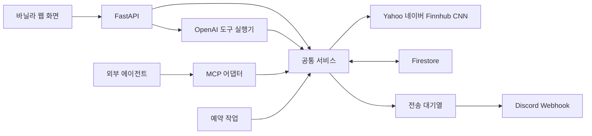
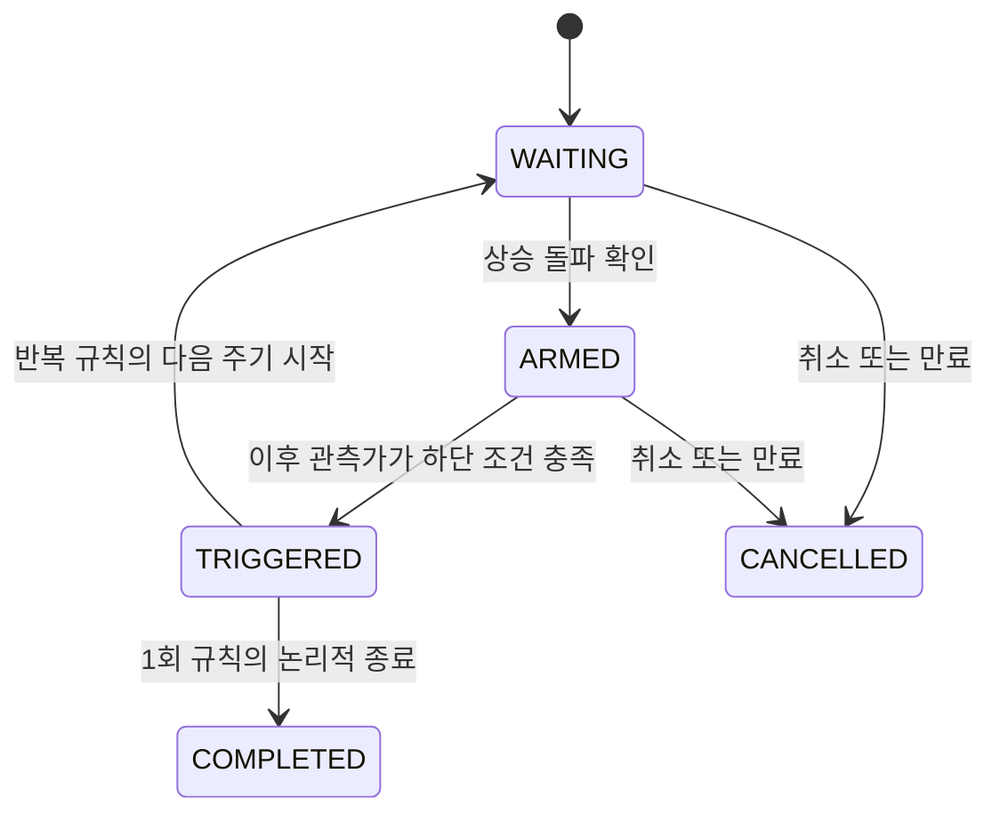

# 한국 미국 주식시장 AI 비서 프로젝트 설계

실제 주가와 뉴스를 바탕으로 시장·관심 종목을 설명하고, Discord 브리핑과 조건부 가격 알림을 제공한다. 같은 수집·계산·조회 기능을 웹 채팅과 외부 MCP 클라이언트에서 사용한다.

이 문서는 전체 기능의 구현 기준이다. 현재 백엔드 기본 환경·실제 일봉 수집·Firestore 저장·과제 필수 API를 구현했다. 화면·뉴스·Discord·MCP·배포는 이후 단계이며, 구체적인 구현 상태와 실행법은 [README](../README.md), 검증 결과는 [검증 기록](verification.md)을 따른다. 기준일은 2026년 10월 21일이다.

## 1 범위와 완료 기준

개인 사용자 한 명의 과제용 서비스로 시작한다. 한국·미국 시장과 소수의 관심 종목을 지원하고, 계좌·주문 연동은 범위에 포함하지 않는다. 실제 공급원에서 수집한 데이터를 저장하며, 수집 실패는 마지막 실제 데이터와 그 기준 시각으로 표시한다.

| 구분 | 구현할 내용 | 완료 기준 |
| --- | --- | --- |
| 과제 필수 | Python 3.10 이상, 가상환경, FastAPI, Firestore, OpenAI | Python 3.11 기준 환경과 의존성을 고정하고 로컬 실행 가능 |
| 과제 필수 | 실제 시계열 데이터 100개 이상 | `data`에 중복을 제외한 실제 일별 관측치 100건 이상, 종목별 개수·기간·출처 확인 |
| 과제 필수 | 데이터 CRUD와 요약 | 지정된 데이터 API 5개가 모두 동작하고, 웹에서 추가·수정·삭제 결과 확인 |
| 과제 필수 | 데이터 기반 AI 채팅 | 서버가 요약을 시스템 컨텍스트에 주입하고 GPT 답변과 로딩 상태 표시 |
| 과제 필수 | 대화 기록 저장과 불러오기 | 자동 저장, 목록, 특정 대화 조회, 삭제 구현; 새로고침 후 같은 기록 복원 |
| 과제 필수 | 웹과 배포 | 바닐라 HTML/CSS/JavaScript, 프런트 Vercel, 백엔드 Render, `/docs` 공개 접근 |
| 과제 필수 | 문서와 제출 화면 | 실행법·환경변수·배포 URL·필수 스크린샷을 README에 기재 |
| 사용자 요구 | 최근 주요 뉴스와 이슈 | 시장·관심 종목별 최근 24시간/7일 조회, 중복 제거, 출처를 포함한 한국어 요약 |
| 사용자 요구 | 변동성과 시장 심리 | 수익률·변동성·RSI·이동평균·거래량·미국 CNN 공포탐욕지수와 VIX 설명 |
| 사용자 요구 | Discord 정기 브리핑 | 한국장·미국장 마감 브리핑, 예약 설정, 전송 이력·실패 표시 |
| 사용자 요구 | 세밀한 목표가 알림 | 단순 도달, 상승·하락 돌파, 순차 조건, 1회/반복·만료·감시 시간대 설정 |
| 사용자 요구 및 보너스 | Function Calling과 MCP | 공통 서비스의 도구 호출, 외부 MCP 클라이언트에서 실제 호출 확인 |
| 선택 보너스 포함 | 그래프·내보내기·다크 모드 | 실제 가격 그래프 1개 이상, CSV/JSON 다운로드, 테마 토글 |

초기 데이터는 KOSPI·KOSDAQ·S&P 500·NASDAQ Composite와 한국·미국 관심 종목 각 2개를 대상으로 최근 1년 일봉을 수집한다. 종목·지수별로 100건 이상을 목표로 하며, 최소 100건 기준을 전체 합계로만 간신히 맞추지 않는다. 신규 상장·결측으로 부족하면 다른 기간·종목을 사용하고 이유를 기록한다.

## 2 공급원과 데이터 기준

| 용도 | 공급원 | 수집 내용 | 초기 갱신 기준 |
| --- | --- | --- | --- |
| 일별 가격과 거래량 | Yahoo Finance / yfinance | OHLCV, 조정 종가, 배당·분할 정보 | 거래소 세션 종료 후 수집, 최근 5거래일 재조회해 정정 반영 |
| 장중 알림 관측값 | Yahoo Finance / yfinance | 이용 가능한 장중 봉의 종가와 시각 | 활성 알림 종목을 장중 5분마다 조회, 완성된 봉만 처리 |
| 국내 뉴스 | 네이버 뉴스 검색 API | 제목·제공된 요약·원문 URL·발행 시각 | 30분 캐시, 관심 종목과 시장 키워드별 조회 |
| 미국 뉴스 | Finnhub Market News / Company News | 제목·제공된 요약·출처·URL·발행 시각 | 30분 캐시, 시장 전체와 관심 종목별 조회 |
| 미국 시장 심리 | CNN Fear & Greed 웹 데이터 | 점수·분류·직전 종가·비교 시점·과거 이력 | 30분 캐시, 일별 이력과 최신 관측값 저장 |
| 미국 기대 변동성 | Yahoo의 VIX 시계열 | VIX 값·최근 변화·과거 분위수 | 일별 분석 중심, 공급원 지연 표시 |

Yahoo 한국 시세의 안내 지연은 20분이다. 수집 주기가 5분이라고 실제 시세를 5분 이내에 알리는 것은 아니다. 앱의 가격 알림은 **수집한 관측 시계열에서 조건을 확인한 알림**으로 정의한다. 종목별 장중 데이터 제공 여부와 지연은 연동 단계에서 검증한다. 해당 종목에서 장중 데이터를 얻지 못하면 감시를 중지하고 이유를 표시한다.

CNN 데이터 주소는 `https://production.dataviz.cnn.io/index/fearandgreed/graphdata`를 사용한다. 정식 개발자 API 계약을 전제로 하지 않는 웹사이트용 주소이므로 파싱과 검증을 별도 공급원 모듈에 둔다. 미국 시장 지표라고 표시하고 한국 고유의 공포탐욕지수로 표현하지 않는다. VIX와 실현 변동성도 서로 다른 지표로 표시한다.

Finnhub의 무료 범위는 분당 60회이며 종목 뉴스는 최근 1년과 신규 업데이트를 지원한다. 뉴스 전문을 항상 확보한다는 전제를 두지 않는다. 공급원이 준 제목·요약을 사용했다면 화면과 답변에 그 근거 범위를 표시한다. Marketaux는 첫 구현의 필수 의존성에 포함하지 않는다.

모든 공급원 결과에는 `provider`, `source_url`, `event_time`, `fetched_at`, `currency`, `timezone`, `resolution`, `delay_seconds`, `quality_status`를 필요한 범위에서 붙인다. 시세의 기준 시각과 서버의 조회 시각은 구분한다. 날짜는 거래소의 거래일, 시간은 UTC 타임스탬프로 저장한다.

| 내부 식별자 예 | Yahoo 코드 | 통화 | 거래소 시간대 |
| --- | --- | --- | --- |
| `KRX_005930` | `005930.KS` | KRW | Asia/Seoul |
| `NASDAQ_AAPL` | `AAPL` | USD | America/New_York |
| `INDEX_KOSPI` | `^KS11` | 지수 포인트 | Asia/Seoul |
| `INDEX_SP500` | `^GSPC` | 지수 포인트 | America/New_York |
| `INDEX_VIX` | `^VIX` | 지수 포인트 | America/New_York |

위 표의 코드는 설정 예이며 실제 값은 수집 시 조회 성공 여부를 검사한다. 종목명·거래소·통화·공급원 코드를 `instruments`에 등록해 같은 티커나 다른 통화를 혼동하지 않는다.

### 분석 규칙

- 기간 수익률: 완료된 거래일의 조정 종가를 사용해 1일·5일·20일·60일 변화를 계산한다. 필요한 이전 관측값이 없으면 값을 만들지 않고 `insufficient_data`를 반환한다.
- 실현 변동성: 최근 20개 일별 로그수익률의 표본 표준편차에 `sqrt(252)`를 곱한다. 252는 연율화 가정이라고 표시한다.
- RSI: 14기간 Wilder 방식, 초기 평균 계산법과 분모가 0인 경우의 규칙을 구현 문서와 테스트에 고정한다.
- 이동평균: 20일·60일 단순이동평균, 현재 값의 이격도와 두 평균의 관계를 계산한다.
- 거래량: 최근 완료 일의 거래량을 그 직전 20개 완료 거래일 평균과 비교한다. 0·결측 거래량은 분모로 사용하지 않는다.
- 최근 추세: 최근 20일 수익률이 +1% 초과면 상승, -1% 미만이면 하락, 나머지는 보합으로 표시한다. 기간·문턱값을 응답에 포함한다.
- 공포탐욕지수: 공급원의 점수·분류를 보존하고 직전 종가·일주일 전·한 달 전과 비교한다. CNN을 그대로 재현하는 자체 계산을 구현한다고 주장하지 않는다.

계산은 Python 함수가 수행한다. AI에는 계산 결과와 출처를 전달해 설명·비교·요약을 맡긴다. 인과관계를 입증하지 못한 뉴스와 가격 변화는 관련 가능성으로 표현한다.

## 3 전체 구조



라우터는 HTTP 입력·응답·인증을 담당하고, 서비스는 실제 동작을 담당한다. 공급원 모듈은 외부 응답을 내부 형식으로 바꾸고, 저장소 모듈은 Firestore 쿼리를 담당한다. 지표 계산과 알림 조건 평가는 외부 API·DB 없이 호출할 수 있는 함수로 둔다.

MCP·예약 작업이 FastAPI 라우터 함수를 직접 호출하지 않는다. 같은 서비스 함수를 호출하므로 계산·검증·출처 형식이 유지된다. 초기 규모에서는 서비스마다 형식적인 인터페이스나 범용 플러그인 계층을 만들지 않는다.

## 4 프로젝트 구조

아래는 구현할 목표 구조다. 파일은 해당 기능을 개발할 때 생성한다.

```text
Codyssey_M1-2/
├── README.md                         소개·실행·배포 URL·제출 증빙
├── pyproject.toml                    Python 의존성·개발 도구
├── requirements.lock                 배포용 버전 고정 파일
├── .env.example                      값 없는 환경변수 예시
├── .gitignore
├── render.yaml                       웹 서비스·선택 예약 작업
├── firebase.json                     에뮬레이터 설정
├── firestore.rules                   브라우저의 DB 직접 접근 차단
├── firestore.indexes.json            필요한 복합 인덱스
├── app/
│   ├── main.py                       앱 생성·CORS·라우터·예외 처리
│   ├── config.py                     환경변수 검증
│   ├── dependencies.py               서비스 생성·인증 주입
│   ├── api/
│   │   ├── data.py                   과제 데이터 CRUD·요약·내보내기
│   │   ├── conversations.py          대화 목록·저장·불러오기·삭제
│   │   ├── chat.py
│   │   ├── market.py                 종목·가격·분석·뉴스·심리지표
│   │   ├── watchlist.py
│   │   ├── alerts.py
│   │   └── briefings.py
│   ├── schemas/
│   │   ├── data.py
│   │   ├── market.py
│   │   ├── conversation.py
│   │   └── automation.py             알림·예약·미리보기 요청
│   ├── services/
│   │   ├── data.py
│   │   ├── market.py
│   │   ├── news.py
│   │   ├── sentiment.py
│   │   ├── chat.py
│   │   ├── alerts.py
│   │   ├── briefings.py
│   │   └── delivery.py
│   ├── domain/
│   │   ├── indicators.py             수익률·변동성·RSI 등
│   │   ├── alert_rules.py            조건 검증·상태 전이
│   │   └── sessions.py               거래소 일정·시간대
│   ├── providers/
│   │   ├── yahoo.py
│   │   ├── naver.py
│   │   ├── finnhub.py
│   │   ├── cnn.py
│   │   ├── openai_client.py
│   │   └── discord.py
│   ├── repositories/
│   │   ├── market.py                 시계열·최신 시세·뉴스·심리
│   │   ├── data.py                   사용자 분석 데이터
│   │   ├── conversations.py
│   │   └── automation.py             알림·예약·브리핑·전송 대기열
│   └── tools/
│       └── registry.py               도구명·입력 스키마·서비스 연결
├── mcp_adapter/
│   └── server.py                     공식 Python SDK 기반 stdio 서버
├── jobs/
│   ├── bootstrap_data.py             최초 실제 데이터 수집
│   ├── tick.py                       예정 작업 선정·실행·종료
│   └── worker.py                     로컬에서 tick을 주기 실행
├── frontend/
│   ├── index.html                    탭으로 구성한 단일 화면
│   ├── styles.css
│   ├── js/
│   │   ├── api.js                    인증 헤더·오류·로딩 공통 처리
│   │   ├── auth.js
│   │   ├── chat.js
│   │   ├── data.js
│   │   ├── market.js
│   │   ├── alerts.js
│   │   └── app.js
│   ├── scripts/build.mjs             공개 설정 주입·정적 파일 복사
│   └── vercel.json
├── tests/
│   ├── unit/                        계산·조건 경계값
│   └── integration/                 API·Firestore·전송 상태
└── docs/
    ├── project-design.md             이 설계
    └── screenshots/                  최종 실제 실행 화면
```

기본 패키지는 과제 지정 `fastapi`, `uvicorn`, `firebase-admin`, `openai`, `python-dotenv`다. 추가로 `yfinance`, `pandas`, `numpy`, `httpx`, 공식 `mcp` Python SDK와 거래일 처리를 위한 `exchange-calendars`를 사용한다. 개발 검증에는 `pytest`를 사용한다. 실제 버전과 Python 호환성은 환경 구성 단계에서 확인하고 고정한다.

프런트는 프레임워크 없이 ES modules를 쓴다. Firebase Authentication용 SDK는 인증 라이브러리로만 사용하고, 가격 그래프는 우선 Canvas로 그린다. Node는 Vercel 빌드 중 공개 설정 파일을 생성하는 용도다.

## 5 HTTP API 설계

### 공통 규칙

`/docs`와 상태 확인을 제외한 개인 데이터 API는 Firebase ID token을 `Authorization: Bearer ...`로 받는다. 서버가 토큰을 검증하고 허용된 사용자 UID와 문서 소유권을 확인한다. 클라이언트가 보낸 `owner_uid`는 신뢰하지 않는다. 개인 과제용으로 허용 UID 한 개를 설정한다.

목록은 `items`, `next_cursor`를 반환하며 `limit` 기본 50, 최대 200이다. 데이터 요약은 목록 첫 페이지만 집계하지 않고 요청한 필터 전체를 집계한다. 초기에는 한 종목·최대 2년으로 범위를 제한한다. 데이터 기간·개수·결측 수·사용 가격 기준·출처·기준 시각도 응답에 포함한다.

PUT과 설정 PATCH는 `expected_revision`을 받아 현재 문서의 `revision`과 비교한다. 생성·전송 요청의 `idempotency_key`는 사용자와 작업 종류 안에서 유일하게 처리한다. 같은 키와 다른 본문을 받으면 409로 거부한다. Pydantic 요청 모델은 알 수 없는 필드를 거부하고, 서버 소유 필드는 응답에만 둔다.

검증 실패는 422, 인증 실패는 401, 권한 실패는 403, 존재하지 않거나 접근할 수 없는 문서는 404로 처리한다. 중복 실행·현재 상태와 충돌하는 요청은 409, 외부 공급원 사용 불가는 캐시 여부에 따라 정상 응답의 품질 상태 또는 503으로 구분한다. 오류에는 `code`, `message`, `request_id`를 넣되 422의 Pydantic 필드 오류 정보는 유지한다.

시세 응답의 품질 상태는 `ok`, `delayed`, `stale`, `partial`, `unavailable`로 구분한다. 캐시 응답에는 실제 `event_time`과 `fetched_at`을 보존한다. 공급원 실패를 0원·지수 0점·가짜 기사로 바꾸지 않는다.

### 과제 지정 API

| 메서드 | 경로 | 입력·처리 | 응답 |
| --- | --- | --- | --- |
| POST | `/api/data` | `date`, `value`, `memo`, `instrument_id` | 201, 저장한 분석 데이터 |
| GET | `/api/data` | 종목·시작일·종료일·cursor·limit | 데이터 목록 |
| PUT | `/api/data/{id}` | `date`, `value`, `memo`, `expected_revision` 전체 수정 | 수정된 데이터 |
| DELETE | `/api/data/{id}` | 소유권 확인 후 삭제 | 204 |
| GET | `/api/data/summary` | 종목·기간 | 기간·개수·평균·최대·최소·최근 추세·출처 |
| POST | `/api/conversations` | 제목, 선택적으로 사용자/assistant 메시지 배열 | 201, 대화 저장 결과 |
| GET | `/api/conversations` | cursor·limit | 제목·갱신 시각·마지막 메시지 미리보기; 전체 messages 미포함 |
| GET | `/api/conversations/{id}` | 메시지 cursor·limit | 대화 메타데이터와 messages, 이전 메시지 cursor |
| DELETE | `/api/conversations/{id}` | 삭제 상태 표시 후 메시지·turn 문서도 삭제 | 작은 대화는 204, 정리 작업이 필요하면 202와 작업 ID |
| POST | `/api/chat` | `message`, 선택적 `conversation_id`, `client_request_id` | 저장된 답변·대화 ID·도구 호출 요약·출처 |

`/summary`, `/statistics`, `/export`, `/import` 같은 고정 경로는 `/{id}`보다 먼저 등록한다. API에서 데이터 CRUD 전체를 구현하고 웹에서도 모두 제공한다. 과제가 허용하는 최소 화면 동작 한 개보다 넓게 검증한다.

`date`는 유효한 거래일 또는 사용자가 지정한 기록일이고, `value`는 유한한 양수다. `memo`는 최대 1,000자다. 시스템이 생성한 공급원 원본과 사용자 분석 데이터의 구분은 DB 설계를 따른다.

### 시장과 사용자 기능 API

| 메서드 | 경로 | 역할 |
| --- | --- | --- |
| GET | `/healthz` | 프로세스 생존 확인; 비밀·계정 정보 미포함 |
| GET | `/api/instruments?query=...&market=KR` | 지원 종목·지수 검색 |
| GET | `/api/market/overview?market=KR` | 시장 대표 지수·변동성·주요 뉴스·기준 시각 |
| GET | `/api/market/{instrument_id}/history` | 실제 일별 시계열과 출처 |
| GET | `/api/market/{instrument_id}/quote` | 최신 이용 가능한 관측가·시각·지연 상태 |
| GET | `/api/analysis/{instrument_id}?period=1y` | 수익률·변동성·RSI·이동평균·거래량 |
| GET | `/api/sentiment/us` | CNN 공포탐욕지수·VIX·비교 값 |
| GET | `/api/news?market=US&instrument_id=...&window=24h` | 출처와 중복 처리가 반영된 뉴스 |
| GET | `/api/watchlist` | 관심 종목과 간단한 상태 |
| POST | `/api/watchlist` | 종목 추가; 같은 종목 중복 추가 방지 |
| DELETE | `/api/watchlist/{instrument_id}` | 관심 종목 제거; 기존 알림은 자동 삭제하지 않음 |
| POST | `/api/data/import` | 한 종목·기간의 실제 데이터 복사, 중복 방지; 초기 대량 수집은 CLI 사용 |
| GET | `/api/data/statistics` | 분석 데이터의 추가 지표와 결측 정보 |
| GET | `/api/data/export?format=csv` | 필터에 해당하는 전체 데이터 CSV/JSON; 페이지 한 장만 내보내지 않음 |
| GET | `/api/alerts` | 규칙·현재 단계·마지막 관측·전송 결과 |
| POST | `/api/alerts/preview` | 자연어/구조화 조건을 검증하고 사람에게 읽히는 조건 반환; 감시 시작 없음 |
| POST | `/api/alerts` | 확인한 구조화 규칙 저장·감시 시작; 멱등 키 필요 |
| PATCH | `/api/alerts/{id}` | 일시정지·재개·규칙 수정; 규칙 변경은 명시적 초기화 |
| DELETE | `/api/alerts/{id}` | 감시 취소; 이미 발생한 전송 기록 보존 |
| GET | `/api/briefing-schedules` | 예약 시각·시간대·대상·활성 여부 |
| POST | `/api/briefing-schedules` | 예약 생성; 멱등 키 필요 |
| PATCH | `/api/briefing-schedules/{id}` | 시간·대상·활성 여부 수정 |
| DELETE | `/api/briefing-schedules/{id}` | 예약 취소 |
| POST | `/api/briefings/preview` | 실제 캐시 데이터를 사용해 브리핑 생성·저장; Discord 발송 없음 |
| POST | `/api/briefings/{id}/send` | 사용자가 선택한 브리핑을 전송 대기열에 등록; 멱등 키 필요 |
| GET | `/api/briefings` | 생성 내용·대상·발송 상태·실패 이유 |
| GET | `/api/jobs/{id}` | 사용자가 요청한 비동기 작업의 상태·오류·완료 결과 |

공급원 강제 갱신·전체 초기화·스케줄러 tick을 공개 GET API로 만들지 않는다. 예약 작업은 Python 서비스 함수를 직접 실행한다. 뉴스·분석 GET은 TTL이 지나면 제한된 갱신을 수행할 수 있지만 Discord 발송이나 사용자 설정 변경은 하지 않는다.

### 채팅 요청 예

```json
{
  "message": "내 관심 종목 중 최근 한 달 변동성이 큰 종목을 비교해줘",
  "conversation_id": null,
  "client_request_id": "클라이언트가 생성한 UUID"
}
```

서버는 질문마다 사용자의 데이터 요약을 내부 서비스에서 조회해 시스템 컨텍스트에 넣는다. 추가 정보가 필요하면 모델의 도구 요청을 검증·실행하고 결과를 다시 모델에 전달한다. 첫 버전은 일반 JSON 응답과 로딩 표시로 구현하고 스트리밍은 필수 범위에 넣지 않는다.

## 6 Firestore 설계

Firestore는 컬렉션과 문서로 구성한다. 가격 이력·대화 메시지·전송 기록을 하나의 커지는 배열에 누적하지 않는다. 과제 지정 `data`, `conversations` 이름을 유지한다.

### 컬렉션

| 경로 | 문서 ID 기준 | 주요 필드 |
| --- | --- | --- |
| `instruments/{id}` | 거래소와 종목/지수 코드 | 이름, 시장, 통화, 시간대, 공급원 코드, 거래소 일정 코드, 지연 설정 |
| `market_bars/{id}` | 종목+resolution+event_time의 해시 | instrument_id, resolution, session_date, open/high/low/close, adjusted_close, volume, event_time, fetched_at, provider, source_url, revision |
| `quotes/{instrument_id}` | 종목 ID | price_decimal, event_time, fetched_at, resolution, delay_seconds, session, quality_status |
| `data/{id}` | 사용자+원본 관측 ID의 해시; 수동 입력은 UUID | owner_uid, instrument_id, date, value, memo, source_bar_id, source_revision, source, user_modified, revision, created_at, updated_at |
| `news_articles/{id}` | 정규화한 원문 URL의 해시 | provider_ids, market, instrument_ids, title, summary, source, source_url, published_at, fetched_at |
| `sentiment/{id}` | `US_CNN_FNG_거래일` 등 | market, provider, value, rating, event_time, fetched_at, 비교 값, source_url, quality_status |
| `watchlists/{uid}/items/{instrument_id}` | 사용자 UID와 종목 ID | added_at, display_order |
| `conversations/{id}` | UUID 또는 chat 요청에서 결정한 ID | owner_uid, title, created_at, updated_at, last_message_preview, message_count, active_turn_id, revision, deleting |
| `conversations/{id}/messages/{id}` | turn ID+role | role, content, created_at, sequence, turn_id, sources, tool_trace_summary |
| `conversations/{id}/turns/{request_id}` | client_request_id | status, lease_until, context_reference, error_code, started_at, completed_at |
| `alerts/{id}` | UUID | owner_uid, instrument_id, rule, stage, last_event_time, last_price_decimal, armed_at, trigger_event_id, cycle, active, expires_at, revision |
| `briefing_schedules/{id}` | UUID | owner_uid, market, instrument_ids, schedule_kind, timezone, local_time/close_offset_minutes, next_run_at, active, destination_alias |
| `briefings/{id}` | schedule ID+대상 slot; 수동은 UUID | owner_uid, market, text, snapshot, sources, generated_at, data_as_of, schedule_id, slot, delivery_status |
| `outbox/{event_id}` | 알림 규칙+cycle, 예약+slot 또는 수동 브리핑 ID에 분할 번호 결합 | owner_uid, kind, payload, destination_alias, status, attempts, available_at, lease_owner, lease_until, message_id, last_error |
| `job_runs/{run_id}` | 작업 종류+대상+시간 slot | kind, owner_uid, target_id, slot, status, lease_owner, lease_until, started_at, completed_at, error_code, source_counts |

`market_bars`는 공급원에서 수집한 기준 데이터다. `data`는 그 실제 관측값을 복사한 사용자의 과제 분석 데이터다. 이 구분으로 사용자는 `(date, value, memo)`를 수정·삭제하면서도 원본 시세를 보존할 수 있다. 기술 분석·가격 알림·시장 브리핑은 기준 데이터를 사용하고, `/api/data/summary`는 사용자의 현재 분석 데이터를 요약한다. 채팅에는 어느 데이터의 요약인지 명시한다.

같은 원본을 다시 가져와도 사용자가 수정한 `data.value`나 `memo`를 덮어쓰지 않는다. 원본 정정은 `source_bar_id`의 revision 차이로 표시하고 명시적 재가져오기에서 반영한다. 실제 원본 100건 증빙에는 최초 수집한 공급원 관측값을 사용하고, 사용자 수정·수동 입력 여부를 별도로 집계한다.

사용자가 데이터를 추가할 때도 실제 관측값을 입력할 수 있다. 서비스의 초기 데이터와 장애 대체값을 임의로 생성하지 않는다. 경계값 단위 테스트용 입력은 운영 데이터베이스에 넣지 않는다.

가격 알림의 금액은 정규화한 십진수 문자열로 저장하고 Python `Decimal`로 비교한다. 분석용 실수와 화면에서 반올림한 값을 조건 판정에 사용하지 않는다. 통화·가격 정밀도를 종목 설정과 함께 검증한다.

### 초기 쿼리와 인덱스

| 조회 | 필요한 인덱스 기준 |
| --- | --- |
| 일별 이력·기간 분석 | market_bars: instrument_id, resolution, event_time |
| 사용자 분석 데이터 | data: owner_uid, instrument_id, date |
| 최근 대화 | conversations: owner_uid, deleting, updated_at 내림차순 |
| 대화 메시지 | messages 서브컬렉션의 sequence; collection group 조회는 하지 않음 |
| 종목별 뉴스 | news_articles: instrument_ids array-contains, published_at 내림차순 |
| 시장별 뉴스 | news_articles: market, published_at 내림차순 |
| 최신 심리지표 | sentiment: market, provider, event_time 내림차순 |
| 사용자 알림 | alerts: owner_uid, active, created_at 내림차순 |
| 예정 브리핑 | briefing_schedules: active, next_run_at |
| 재시도할 전송 | outbox: status, available_at; 만료 lease 조회는 별도 쿼리 |
| 최근 브리핑 | briefings: owner_uid, generated_at 내림차순 |

`alerts.created_at`처럼 정렬에 쓰는 공통 시각 필드는 모든 사용자 문서에 둔다. 인덱스는 실제 API 쿼리에 맞춰 통합 테스트로 확정하고 `firestore.indexes.json`에 저장한다. 뉴스 전문·브리핑 본문처럼 검색에 사용하지 않는 긴 필드는 인덱싱에서 제외한다.

대화 메시지는 페이지별로 읽어 프런트에서 이어 붙인다. DB의 문서 크기 한계는 1 MiB이고 부모 문서를 지워도 서브컬렉션은 자동 삭제되지 않으므로, 대화 삭제는 `deleting` 표시 → 메시지·turn 삭제 → 부모 삭제 순으로 처리한다. 삭제 중에는 목록·채팅에서 제외하고 중단된 정리는 작업에서 재개한다.

브라우저는 Firestore를 직접 읽고 쓰지 않는다. `firestore.rules`에서 클라이언트 DB 접근을 막고, Admin SDK를 사용하는 FastAPI가 UID·소유권을 검사한다. Admin SDK는 클라이언트 보안 규칙에 의존하지 않으므로 서비스별 권한 검증이 필요하다.

## 7 조건부 가격 알림

### 규칙 표현

조건은 허용된 연산자로만 표현한다. `eval`이나 임의 Python/SQL 실행을 허용하지 않는다. UI는 단계별 조건 편집과 자연어 초안을 모두 지원하되 저장 전 같은 구조화 규칙을 보여준다.

```json
{
  "instrument_id": "KRX_사용자가선택한종목코드",
  "currency": "KRW",
  "steps": [
    {"op": "cross_above", "price": "35000"},
    {"op": "lte", "price": "30000"}
  ],
  "session_scope": "regular",
  "repeat_mode": "once",
  "expires_at": null,
  "step_timeout_hours": null
}
```

지원 연산자는 `gt`, `gte`, `lt`, `lte`, `cross_above`, `cross_below`다. 처음에는 1~3개 단계의 순차 조건과 한 단계 안의 단순 AND 조건까지 제공한다. 임의로 중첩되는 논리식 편집기는 이후 확장으로 남긴다. 상대 하락률 같은 조건을 추가할 때는 기준가와 기준 시점을 반드시 함께 정의한다.

단순 단계는 위 예처럼 `op`, `price`를 사용하고, AND 단계는 `all` 배열에 단순 조건을 넣는다. AND 단계의 모든 조건은 같은 새 관측값에서 참이어야 한다. 단계가 바뀐 관측값은 다음 단계에서 다시 사용하지 않는다. 각 단계의 `entered_at`과 마지막 충족 근거를 상태에 저장한다.

문장 해석 예는 “등록 이후 이전 관측가가 35,000원 이하에서 새 관측가가 35,000원 초과로 바뀐 뒤, 더 나중 관측가가 30,000원 이하가 되면 1회 알림”이다. 최초 관측가가 이미 35,000원을 넘으면 기준값으로만 저장한다. 사용자가 원하면 `gt`로 바꿔 이미 초과한 상태도 인정할 수 있다.



`TRIGGERED`는 조건 발생 상태이며 Discord 발송 성공을 뜻하지 않는다. 발송 상태는 `outbox`에서 관리한다. 반복 규칙은 cycle을 증가시키고 현재 관측값을 다음 주기의 기준값으로 둔다. 같은 관측값에서 다시 조건을 평가하지 않는다. 단계 제한 시간이 있으면 초과 시 WAITING으로 초기화하고 그 이유를 남긴다.

### 평가와 전송

1. 종목별 완성된 장중 봉을 가져와 종가 관측 시각순으로 정렬한다. 각 봉의 시작 시각과 종료 시각을 정규화한다.
2. 중복·역순 관측값을 제거하고 마지막 처리 시각보다 이후인 값만 평가한다. 재시작 시 제공되는 기간 안에서 누락된 완성 봉을 순서대로 복구한다.
3. 지연·거래 시간·통화·결측을 검사한다. 예상 지연+봉 간격+조회 간격+허용 오차보다 오래된 최신값은 stale로 표시하고 새 판정을 중지한다. 복구 이력은 별도 replay 경로에서 처리한다.
4. 알림 문서를 트랜잭션으로 읽고 상태를 전환한다. 조건 발생 시 동일 트랜잭션에서 고유 `event_id`의 outbox 문서도 생성한다.
5. 별도 전송기가 lease를 얻어 Discord에 전송하고 결과를 기록한다. Firestore 트랜잭션 내부에서 외부 HTTP 요청을 하지 않는다.

5분 봉의 종가로 조건을 평가하면 봉 내부에서 잠시 발생한 돌파·하락은 놓칠 수 있다. 고가·저가가 두 문턱을 모두 지났어도 선후를 추정하지 않는다. 화면의 조건 설명에 관측 주기·정규장 여부·지연을 표시한다. 분할·병합 등 기업행위로 기준 가격이 달라지면 감시를 일시정지하고 새 문턱값을 확인하도록 한다.

유효하지 않은 데이터 단절을 가로질러 새 돌파를 추정하지 않는다. ARMED는 명시적 만료가 없는 한 보존하고, 복구 시 첫 신선한 이후 관측가에 하단 조건을 적용할 수 있다. 이 경우 “공백 이후 첫 관측에서 확인”이라고 표시하며 최초 실제 발생 시각이라고 표현하지 않는다. WAITING의 crossing 기준값은 관측이 끊겼으면 다시 설정한다.

429는 서버의 재시도 안내에 따르고, 5xx·타임아웃은 지연을 늘려 최대 5회 재시도한다. `wait=true` 응답의 메시지 ID를 저장하고 브리핑을 약 1,800자 단위로 나눠 전송한다. `allowed_mentions`를 비워 뉴스나 모델 출력이 전체 멘션을 만들지 않게 한다.

DB 상태와 outbox 생성은 중복을 막을 수 있지만 Discord 수신까지 정확히 한 번을 보장할 수는 없다. 전송 성공 후 응답이 유실되면 재시도에서 중복될 수 있다. 메시지에 같은 event ID를 포함하고 전송 이력에 불확실한 결과를 남긴다. 문구만으로 수신 측 중복 제거가 구현되었다고 주장하지 않는다.

## 8 브리핑과 예약 실행

기본 브리핑은 한국장과 미국장 각각의 실제 세션 종료 40분 후다. 평소에는 한국 16:10, 미국 현지 16:40에 해당한다. 미국 브리핑의 한국 시각은 서머타임에 따라 바뀌므로 매일 같은 UTC 시각을 사용하는 반복 규칙으로 만들지 않는다. 조기 폐장·휴장일은 거래소 일정으로 계산한다. 사용자는 별도로 Asia/Seoul 08:00 같은 고정 시각도 선택할 수 있다.

예약의 기준은 `schedule_kind`와 거래소/시간대·현지 시각·마감 후 간격이다. `next_run_at`은 이 규칙에서 계산한 **다음 한 번의 실행 시각을 UTC로 저장한 파생 값**이다. 실행 완료·예약 변경 시 다음 회차를 계산하고, 매일 일정 갱신 시에도 재계산해 휴장·조기 폐장 변경을 반영한다.

브리핑에는 시장 지수 변화, 변동성·시장 심리, 주요 이슈 3~5개, 관심 종목별 변화와 관련 뉴스, 다음 확인 항목을 넣는다. 뉴스 범위는 이전 성공 브리핑 이후를 기본으로 하되 첫 생성은 최근 24시간을 쓴다. 각 숫자의 거래일·시각과 출처를 보존한다. 일부 공급원이 실패하면 해당 부분을 미확인으로 표시해 나머지 브리핑은 생성할 수 있다.

브리핑 생성 결과를 먼저 `briefings`에 저장한다. 예약+대상 slot으로 결정한 event ID를 outbox에 넣고 발송한다. 동일 예약을 같은 slot에 다시 실행해도 새로운 브리핑·전송 요청을 중복 생성하지 않는다. 슬롯 획득은 트랜잭션과 만료 lease로 관리한다. 중단 시 같은 run을 재개하고 이미 완료한 결과를 재사용한다.

### 실행 환경

| 구성 요소 | 배치 | 실행 방식 |
| --- | --- | --- |
| 프런트 | Vercel | 정적 HTML/CSS/JS |
| HTTP API·Swagger | Render Web Service | FastAPI, 요청 처리 |
| DB | Firebase Firestore | 실제 데이터·사용자 설정·작업 상태 저장 |
| 최초 수집 | 로컬 CLI | 지정 종목의 실제 데이터 수집·건수 검증 |
| 개발 중 예약 실행 | 로컬 worker | 5분마다 tick, 프로그램이 켜진 동안 동작 |
| 배포 후 예약 실행 | 선택한 Render Cron Job 1개 | 5분마다 `python -m jobs.tick`, 작업 후 종료 |
| 외부 채팅의 MCP | 로컬 stdio 프로세스 | MCP 호스트가 실행하고 공통 서비스 호출 |

Render 무료 웹 서비스의 프로세스 안에 지속 타이머를 두지 않는다. 예약 작업은 웹 서비스가 잠들어 있어도 독립 실행하며, 시세 감시와 전송 대기열 처리를 포함한다. tick 한 번의 공급원 오류가 다른 종목·작업 처리를 모두 중단시키지 않게 한다.

데이터 공급원은 무료 범위를 사용하지만 Render Cron Job은 별도 인프라 과금이 있으며 현재 서비스당 월 최소 1달러다. 전부 무료로 시연할 때는 로컬 worker를 사용한다. 이 경우 컴퓨터가 꺼져 있을 때 알림이 실행된다고 안내하지 않는다. 정기 알림의 지속성을 포함한 배포 완료 기준은 독립 스케줄러 연결까지다.

tick은 봉을 가져올 종목을 합쳐 요청 수를 줄인다. `job_runs`에는 성공·실패·걸린 시간·수집 건수를 기록한다. 실제 시세 기준 시각은 늦을 수 있으므로 스케줄러 실행 성공과 데이터 최신성을 별도로 표시한다.

## 9 채팅과 MCP 도구

### 공통 도구 목록

| 도구명 | 입력 예 | 반환 내용 | 분류 |
| --- | --- | --- | --- |
| `summarize_dataset` | 종목·기간 | 사용자 데이터 요약·수정 여부 | 조회 |
| `get_market_overview` | KR/US | 시장 지수·뉴스·상태 | 조회 |
| `get_quote` | 종목 ID | 관측가·기준 시각·지연 | 조회 |
| `get_price_history` | 종목·기간·간격 | 제한된 길이의 시계열·출처 | 조회 |
| `calculate_indicators` | 종목·기간·지표 목록 | Python 계산 결과 | 조회·계산 |
| `search_news` | 시장·종목·기간 | 제목·요약·시각·원문 링크 | 조회 |
| `get_us_sentiment` | 비교 기간 | CNN·VIX·과거 비교 | 조회 |
| `list_alerts` | 활성 여부 | 내 알림 규칙과 상태 | 조회 |
| `preview_alert_rule` | 자연어 또는 steps | 구조화 조건과 해석·오류 | 미리보기 |
| `create_alert` | 확인한 규칙·멱등 키 | 저장한 알림 | 사용자 설정 변경 |
| `preview_briefing` | 시장·종목·기간 | 전송 전 실제 데이터 브리핑 | 생성 |

Discord 전송은 예약 저장·웹의 발송 버튼에서 명시한 범위로 실행한다. 초기 MCP는 조회·계산·알림 생성까지 제공하며, 임의 채널로 즉시 메시지를 보내는 도구는 노출하지 않는다. `create_alert`는 조건 미리보기와 사용자의 명시적 확정 이후에만 사용한다. 일반 폼의 저장 버튼은 그 확정 동작으로 본다.

### 채팅 처리 흐름

1. 토큰·소유권·입력 길이를 검증한다. 사용자 발화는 최대 4,000자다.
2. `client_request_id`로 대화의 turn을 선점하고 사용자 메시지를 저장한다. `conversation_id=null`이면 고정 namespace와 `owner_uid + client_request_id`로 UUID5 대화 ID를 계산한다. 응답을 받기 전 실패해도 같은 요청 재전송에서 같은 부모 문서와 turn을 찾는다. 대화의 `active_turn_id` 설정과 turn 생성은 트랜잭션으로 처리한다.
3. `data/summary`와 같은 서비스로 요약을 조회하고 서버가 시스템 컨텍스트에 넣는다. 최근 대화·관심 종목·기준 시각·출처를 제한된 길이로 추가한다.
4. OpenAI Responses API를 호출한다. 도구 호출이 오면 허용 목록·Pydantic 스키마·권한을 검사한 뒤 공통 서비스를 실행하고 결과를 모델에 전달한다.
5. 최종 assistant 메시지·출처·도구 실행 요약을 저장하고 turn을 완료한다. 응답은 저장이 확인된 뒤 반환한다.

모델 출력 토큰·도구 실행 횟수·뉴스 건수에 상한을 둔다. 초기 기본은 응답 최대 1,200토큰, 도구 최대 5회, 도구 왕복 최대 3회다. 상한에 도달하면 확보한 정보와 확인하지 못한 항목을 답한다. 모델은 환경변수로 지정하고 사용할 계정에서 제공되는 모델을 선택한다.

모델 호출과 Firestore 쓰기는 하나의 원자적 트랜잭션으로 묶을 수 없다. turn 상태를 `running/completed/failed`로 관리하고, 같은 요청을 다시 받으면 완료 결과를 재사용한다. 모델 오류는 사용자 발화와 실패 상태를 남기며 assistant 답변을 만들어 저장하지 않는다. 같은 대화에서 다른 turn이 실행 중이면 409로 알려 동시 메시지 순서 충돌을 막는다. 네트워크 실패 중 모델 호출이 중복 실행되는 비용까지 정확히 한 번으로 보장하지 않는다.

뉴스·외부 문서·사용자 데이터 메모는 분석 자료로 취급한다. 자료 안의 문장을 시스템 지시나 도구 실행 승인으로 사용하지 않는다. 도구 호출은 모델이 제안해도 서버가 허용 목록과 사용자 권한으로 결정한다. 웹 출력에는 `textContent`를 쓰고 링크의 스킴을 검증한다.

### 외부 MCP 연결

초기 제출물은 공식 Python SDK의 stdio 서버다. 외부 MCP 호스트에 Python 실행 파일과 `-m mcp_adapter.server` 인수를 등록한다. 로컬 환경의 서비스 계정 자격과 `MCP_OWNER_UID`를 사용해 고정된 한 사용자의 범위만 접근한다. 요청 인수로 임의 UID나 서비스 계정 경로를 받지 않는다. stdout은 프로토콜에만 쓰고 로그는 stderr로 보낸다.

외부 호스트에서 실제 주가 조회와 지표 계산을 호출하고, 같은 입력의 웹/Function Calling/MCP 결과를 비교한다. 도구명·입력·출처·기준 시각을 README에 기록한다. 이 방식으로 사용자 요구인 MCP 서버 패킹과 과제의 외부 채널 호출을 충족한다. 원격 Streamable HTTP와 별도 OAuth 구축은 초기 제출 범위 이후로 둔다.

## 10 화면 설계

단일 `index.html` 안에서 탭을 전환한다. 새로고침 시 선택 탭과 테마를 복원한다. 로그인 후 내 데이터만 표시한다.

| 탭 | 주요 요소 |
| --- | --- |
| 시장 | KR/US 선택, 대표 지수, 변동성, 미국 심리지표, 최근 주요 뉴스, 실제 가격 그래프 |
| 관심 종목 | 검색·추가·삭제, 종목별 수익률·지표·관련 뉴스, 알림 설정 진입 |
| AI 채팅 | 대화 목록, 현재 요약 카드, 질문·답변, 로딩·오류·재시도, 사용한 도구와 출처 펼치기 |
| 데이터 관리 | 종목·기간 필터, 출처·건수·요약, 실제 데이터 가져오기, 추가·수정·삭제, CSV/JSON 내보내기 |
| 알림 | 단계별 조건, 자연어 미리보기, 가격 기준·지연 설명, 상태·일시정지·취소·반복·만료 |
| 브리핑 | 시장·종목·시각·시간대 선택, 생성 미리보기, 예약, 발송 이력·실패 |

초기 화면에서 공급원을 기다리다 멈춘 것처럼 보이지 않게 로딩 상태를 표시한다. Render 첫 요청 지연 안내, 데이터가 없는 상태, 일부 공급원 장애, 실제 데이터 시각과 조회 시각을 각각 구분한다. 기본 시각 표시는 KST이고 거래소 날짜도 함께 표시한다.

## 11 환경변수와 배포 설정

| 환경 | 변수 | 용도 |
| --- | --- | --- |
| 백엔드·작업·MCP | `OPENAI_API_KEY`, `OPENAI_MODEL` | 모델 호출과 사용할 모델 |
| 백엔드·작업·MCP | `FIREBASE_SERVICE_ACCOUNT_JSON` 또는 `GOOGLE_APPLICATION_CREDENTIALS` | 서버 자격; 둘 중 하나 |
| 백엔드·작업·MCP | `FIREBASE_PROJECT_ID` | 대상 프로젝트 |
| 백엔드 | `ALLOWED_ORIGINS`, `ALLOWED_USER_UIDS` | 프런트 출처와 개인 사용자 제한 |
| 작업·MCP | `MCP_OWNER_UID`, `JOB_OWNER_UID` | 각 실행 주체의 소유 범위 |
| 백엔드·작업·MCP | `NAVER_CLIENT_ID`, `NAVER_CLIENT_SECRET`, `FINNHUB_API_KEY` | 뉴스 수집 |
| 작업·백엔드 발송 처리 | `DISCORD_WEBHOOK_URL` | 지정 채널 발송; DB에는 alias만 저장 |
| 백엔드·작업 | `DATA_POLL_MINUTES`, `NEWS_CACHE_MINUTES`, `SENTIMENT_CACHE_MINUTES` | 기본 5·30·30분 |
| 백엔드 | `OPENAI_MAX_OUTPUT_TOKENS`, `MAX_TOOL_CALLS` | 요청당 사용량 제한 |
| 프런트 빌드 | `API_BASE_URL` | Render API 주소 |
| 프런트 빌드 | `FIREBASE_WEB_CONFIG_JSON` | 공개 Firebase Auth 설정 |
| 로컬 검증 | `FIRESTORE_EMULATOR_HOST`, `FIREBASE_AUTH_EMULATOR_HOST` | 검증 전용 에뮬레이터 |

Yahoo와 CNN 수집에는 별도 API 키가 필요하지 않다. 서비스 계정·OpenAI·뉴스 키·Webhook URL은 정적 JS에 넣지 않는다. Firebase 웹 설정은 서버 서비스 계정과 다른 공개 설정이며, API 인증은 ID token 검증으로 수행한다.

바닐라 JS는 Vercel의 서버 환경변수를 브라우저에서 직접 읽지 못하므로, `frontend/scripts/build.mjs`가 공개 허용 목록인 API 주소와 Firebase 웹 설정만 `dist/config.js`에 기록한다. 비밀값이나 전체 `process.env`를 복사하지 않는다. 설정 변경 후 새 배포로 반영한다.

Render의 시작 명령은 프로젝트 루트에서 `uvicorn app.main:app --host 0.0.0.0 --port $PORT`로 설정한다. DB와 작업 상태를 로컬 파일에 의존하지 않는다. 백엔드 CORS에 Vercel의 확정 프런트 URL과 로컬 개발 주소를 등록한다. Swagger에는 Bearer 인증 입력을 제공해 실제 API 검증이 가능하게 한다.

배포 URL은 실제 생성 이후 README에 기록한다. 현재 존재하지 않는 URL이나 스크린샷을 제출 증빙으로 만들지 않는다.

## 12 개발 순서와 검증

아래 시간은 과제의 80시간을 배분한 계획이며 구현 난도·키 발급·배포 환경에 따라 달라질 수 있다. 각 단계의 완료 기준을 통과한 뒤 다음 단계로 이동한다. 외부 키 발급과 계정 준비는 1단계에서 병행한다.

| 순서 | 예상 시간 | 구현 내용 | 완료 기준 |
| --- | --- | --- | --- |
| 1 | 4시간 | Python 환경, 설정 검증, FastAPI, CORS, Firebase Auth·Firestore, 계정·키 준비 | `/healthz`, `/docs`, 로그인·허용 UID 검증; 키 누락 오류가 명확함 |
| 2 | 10시간 | 종목 설정, Yahoo 일봉, Firestore 저장, 최초 수집 CLI | 한국·미국 각각 실제 이력 저장, `data` 100건 이상, 재수집 중복 없음 |
| 3 | 10시간 | 지정 데이터 API·요약·추가 통계·데이터 관리 화면 | CRUD 후 목록·요약 갱신, 유효성 오류, 원본 시세 보존 |
| 4 | 8시간 | 대화 API, 메시지 페이지, 대화 목록·불러오기·삭제 | 새로고침 복원, 소유권 거부, 삭제 후 하위 문서 정리 |
| 5 | 12시간 | OpenAI 컨텍스트 주입, 채팅 자동 저장, 공통 도구 실행 | 실제 요약에 근거한 답변, 로딩, 동일 요청 재전송·도구 실패 처리 |
| 6 | 10시간 | 기술지표, Naver·Finnhub 뉴스, CNN·VIX, 시장·관심 종목 화면 | 출처·기준 시각을 포함한 분석, 공급원별 부분 장애, 실제 그래프 |
| 7 | 8시간 | 브리핑 생성, 예약 설정, tick, outbox·Discord | 시장별 실제 데이터 브리핑 전송, 같은 slot 중복 실행 방지·재시도 |
| 8 | 8시간 | 규칙 편집·미리보기, 순차 조건 엔진, 장중 데이터, 알림 화면 | 돌파 후 하락, 재시작 복원, 중복/역순 관측, 만료·반복·전송 실패 검증 |
| 9 | 6시간 | 공통 도구 MCP 연결, 외부 클라이언트 실증, 내보내기·다크 모드 | 외부 도구 호출과 웹 결과 일치, CSV/JSON, 테마 복원 |
| 10 | 4시간 | Render·Vercel·선택 스케줄러 배포, 최종 검증·README·스크린샷 | 필수·사용자 기능 확인표 완료, 실제 배포 URL과 증빙 기록 |
| 합계 | 80시간 | 필수 요구사항과 사용자 기능 모두 포함 | 완료되지 않은 항목은 제출 문서에 명시 |

배포 막판의 연결 문제를 줄이기 위해 3단계 종료 시 데이터 화면과 API를 한 번 배포한다. 10단계는 이미 배포한 구성을 마무리하고 전체 흐름을 확인하는 시간으로 사용한다.

### 위험에 맞춘 검증

| 대상 | 주요 검증 |
| --- | --- |
| 실제 데이터 | 공급원·기간·시각, 일자 중복 없음, 최소 100건, 통화·거래소 일치, 결측을 0으로 대체하지 않음 |
| 통계 | 알려진 작은 입력에서 수익률·표본 표준편차·RSI 계산 일치, 부족한 기간·분모 0 처리 |
| 데이터 CRUD | 실제 API 전체, revision 충돌, 수정한 사용자 데이터 재수집 보존, 원본·알림 시세 불변 |
| 채팅·대화 | 요약이 서버 컨텍스트에 들어감, 자동 저장·불러오기, 동일 request ID 재전송, 공급원·모델·저장 실패 |
| 순차 알림 | 35,000원에서 돌파하지 않음, 35,000→35,001에서 ARMED, 이후 30,000에서 발생, 순서 반대는 무발생 |
| 알림 복원 | 최초 초과값은 기준값만 설정, 중복·역순 처리 없음, 재시작 후 ARMED 보존, 같은 event의 outbox 1개 |
| 알림 범위 | 봉 내부 고저로 선후 추정 없음, 지연·관측 공백·휴장·기업행위·반복 초기화 처리 |
| 예약·전송 | 같은 slot 재실행, lease 만료 복구, Discord 429/5xx/타임아웃, 전송과 상태 저장 사이 실패 |
| 권한 | 미로그인·허용되지 않은 UID·타인 문서 접근 거부, 로컬 MCP의 고정 사용자 범위 |
| 도구 | 동일 입력의 HTTP·Function Calling·MCP가 같은 서비스 결과 사용, 스키마 밖 인수 거부 |
| 실제 통합 | Yahoo 한국·미국 수집, Naver/Finnhub 키 호출, CNN 파싱, OpenAI 답변, 지정 Discord 채널 전송 |
| 웹·배포 | 로딩·빈 화면·오류·콜드스타트 안내, Vercel→Render CORS, 환경변수 주입, 모바일 기본 레이아웃 |

단위·에뮬레이터 테스트는 개발 데이터로 경계값을 검증하고, 실제 외부 호출은 별도 통합 점검에서 제한된 횟수로 수행한다. 실제 외부 API 장애를 테스트 통과로 숨기지 않는다. 외부 통합 점검을 실행하지 못하면 해당 항목을 미검증으로 표시한다.

### 제출 증빙

- 실제 데이터의 기간·개수·출처가 보이는 화면과 Firestore 저장 확인.
- 데이터 요약 카드, 사용자의 질문과 AI 답변이 함께 보이는 채팅 화면.
- 데이터 추가·수정·삭제 중 최소 한 동작의 전후가 보이는 데이터 관리 화면.
- 이전 대화를 선택해 메시지를 불러온 화면.
- 배포된 프런트 URL·백엔드 URL·Swagger URL과 인증하여 실행한 API.
- 실제 자료의 Discord 브리핑, 알림 상태 전이·전송 이력; 경계 조건 시험 결과는 실제 시장 발생 알림과 구분.
- 도구 선택 이유·입력·실행 결과·출처를 보여주는 Function Calling 기록과 외부 MCP 호출 기록.
- README의 기술 스택·로컬 실행법·환경변수·배포법·제한 사항·스크린샷 링크.

## 13 참고 자료

과제 기준은 사용자가 제공한 「AI Agent 개발 나만의 AI 비서 구축」 PDF다. 외부 서비스의 세부 조건은 아래 공급원·공식 문서를 따른다. 사용자 요구에 따른 실제 데이터 사용과 확정한 공급원 조합을 설계의 기준으로 삼는다.

- [yfinance 문서](https://ranaroussi.github.io/yfinance/)
- [yfinance 다운로드와 간격](https://ranaroussi.github.io/yfinance/reference/api/yfinance.download.html)
- [Yahoo 거래소별 시세 지연](https://help.yahoo.com/kb/finance/article-exchanges-data-delays-sln2310.html)
- [네이버 뉴스 검색](https://developers.naver.com/docs/serviceapi/search/news/news.md)
- [Finnhub 요금제](https://finnhub.io/pricing)
- [Finnhub 시장 뉴스](https://finnhub.io/docs/api/market-news)
- [Finnhub 종목 뉴스](https://finnhub.io/docs/api/company-news)
- [CNN 실제 시장 심리 데이터](https://production.dataviz.cnn.io/index/fearandgreed/graphdata)
- [Cboe VIX 설명](https://www.cboe.com/tradable-products/volatility-trading/)
- [OpenAI Function Calling](https://developers.openai.com/api/docs/guides/function-calling)
- [MCP 서버 개발](https://modelcontextprotocol.io/docs/develop/build-server)
- [Firestore 데이터 모델](https://firebase.google.com/docs/firestore/data-model)
- [Firestore 트랜잭션](https://firebase.google.com/docs/firestore/manage-data/transactions)
- [Firestore 제한](https://firebase.google.com/docs/firestore/quotas)
- [Firebase ID token 검증](https://firebase.google.com/docs/auth/admin/verify-id-tokens)
- [거래소 일정 라이브러리](https://github.com/gerrymanoim/exchange_calendars)
- [Discord Webhook](https://docs.discord.com/developers/resources/webhook)
- [Render 무료 서비스](https://render.com/docs/free)
- [Render 예약 작업](https://render.com/docs/cronjobs)
- [Vercel 환경변수](https://vercel.com/docs/environment-variables)
